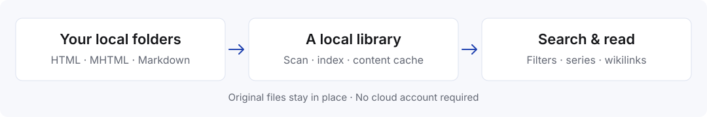

<div align="center">


**English** · [简体中文](README.zh-CN.md)

**A local library for web archives and Markdown notes.**<br>
Keep your files where they are. Search, read, and explore connected ideas in one calm workspace on your Mac.

[](https://github.com/WYgao29/PageShelf/releases/latest)
[](#quickstart)
[](#features)
[](docs/DEVELOPMENT.md)
[](https://github.com/WYgao29/PageShelf/commits/main)

[Download for Mac](https://github.com/WYgao29/PageShelf/releases/latest) · [Quickstart](#quickstart) · [简体中文使用指南](docs/guide.zh-CN.md)


</div>

## Contents

[Why](#why) · [Features](#features) · [How it works](#how-it-works) · [Quickstart](#quickstart) · [Search](#search) · [Screenshots](#screenshots) · [Keyboard shortcuts](#keyboard-shortcuts) · [FAQ](#faq) · [Development](#development) · [Contributing](#contributing)

## Why

Saved pages tend to disappear into folders. A useful article becomes a forgotten filename; a set of notes loses its reading order; finding one paragraph means opening file after file.

PageShelf gives those files a shared reading space. Add a folder, search across its contents, and switch between a clean reading view and the original page. Your HTML, MHTML and Markdown files stay in their original locations, ready for your usual editors and file tools.

## Features

| | Feature | Details |
| --- | --- | --- |
| 📁 | **Your folders, your files** | Add multiple local sources. Rename, reorder, pause, relocate or rescan them. Removing a source leaves its files in place. |
| 📄 | **Three familiar formats** | Read HTML, MHTML web archives and Markdown. Files with the same path and stem are grouped as one article with multiple formats. |
| 🔍 | **Full-text search** | Search titles, body text, series, tags and paths. Combine terms, match phrases, exclude words, and filter by source, format or article type. |
| 📖 | **A focused reader** | Extracted reading view, original webpage and Markdown when available. Navigate headings with a table of contents and jump between search matches. |
| 🧵 | **Series and connections** | Numbered files become ordered series with previous/next navigation. Follow Markdown wikilinks within the same source. |
| 🌗 | **A workspace that fits** | Light, dark and system themes; four reading sizes; adjustable columns; keyboard navigation and restored navigation state. |
| 🖥️ | **Local desktop app** | Reading and search run on your Mac. Archived-page scripts are disabled; external links ask before opening in your browser. |
| 🗑️ | **System Trash integration** | Review associated files before moving them to macOS Trash. Restore them in Finder and rescan the source. |

## How it works



The app rebuilds its index at startup and keeps a local cache of extracted content. After changing files outside PageShelf, rescan the source to refresh the library.

## Quickstart

### Download

1. Download `PageShelf-0.1.0-macOS-arm64.zip` from [Releases](https://github.com/WYgao29/PageShelf/releases/latest).
2. Unzip it and drag **PageShelf.app** into **Applications**. The current build is for **Apple Silicon Macs**.
3. Open the app, click **添加目录** (Add folder), and choose a folder containing your saved pages or notes.

The app is currently unsigned and not notarized. If macOS blocks the downloaded app, review it in **System Settings → Privacy & Security** and choose **Open Anyway** after confirming its source.

### Try the sample library

Clone or download this repository, then add `examples/library/reading`, `examples/library/design` and `examples/library/projects` as sources. These original sample articles are also used in the screenshots.

### Build from source

Use Node.js 24 LTS (24.15+ within the 24.x line), or Node.js 26+, on macOS.

```sh
git clone https://github.com/WYgao29/PageShelf.git
cd PageShelf
npm ci
npm run dev
```

To create the Apple Silicon app:

```sh
npm run package:mac
open release/PageShelf-darwin-arm64
```

## Search

| Query | Finds |
| --- | --- |
| `本地 搜索` | Articles containing both terms |
| `"阅读视图"` | An exact phrase |
| `搜索 -临时` | Articles containing 搜索, excluding 临时 |

Use the source, format and type controls to narrow results. Matches are highlighted in the list and reader; `n` and `Shift+N` move between body matches.

## Screenshots

| Dark reading view | Full-text search |
| --- | --- |
|  |  |

<details>
<summary><b>Source folder management</b></summary>


</details>

All screenshots show the real desktop application using the included sample library. The current interface is in Simplified Chinese.

## Keyboard shortcuts

| Shortcut | Action |
| --- | --- |
| `⌘K` or `/` | Focus search |
| `j` / `k` / `Enter` | Next article / previous article / open |
| `[` / `]` | Previous / next article in a series |
| `v` | Switch reading view |
| `n` / `Shift+N` | Next / previous body match |
| `t` | Switch theme |
| `⌘\` | Toggle sidebar |
| `Shift+M` | Manage source folders |
| `⌘[` / `⌘]` | Back / forward |
| `?` | Open shortcut help |

## FAQ

<details><summary><b>Does it upload my files or require an account?</b></summary>

No. Reading, indexing and search happen locally. PageShelf does not require a cloud account or an AI API key.
</details>

<details><summary><b>Does it download webpages?</b></summary>

PageShelf reads files you have already saved. Save a webpage as HTML or MHTML using your browser, then add its folder as a source.
</details>

<details><summary><b>What happens when I remove a source?</b></summary>

Only its index is removed; the original files stay where they are. Moving an article to Trash is a separate action with a confirmation listing the associated files.
</details>

<details><summary><b>Will all archived pages look exactly like the live website?</b></summary>

PageShelf provides both an extracted reading view and an original-page view. Scripts are disabled, and remote images do not load automatically. Embedded MHTML images and supported local images can be displayed. Short HTML that cannot provide enough extracted text falls back to the original page.
</details>

<details><summary><b>Does it track read status, bookmarks or reading progress?</b></summary>

Not currently. It restores navigation, theme, text size and column widths, but does not persist read status, bookmarks or scroll position.
</details>

<details><summary><b>Where are settings stored?</b></summary>

Library configuration and content cache live in `~/.html-library/`. Interface preferences live in `~/Library/Application Support/PageShelf/`. Your source files stay in their original folders.
</details>

## Development

```sh
npm test
npm run check
```

See the [development guide](docs/DEVELOPMENT.md) for architecture, targeted tests, packaging and reproducible screenshots. A detailed [Chinese user guide](docs/guide.zh-CN.md) covers folder management, search, reading and recovery.

## Contributing

[Issues](https://github.com/WYgao29/PageShelf/issues) and pull requests are welcome. For a bug report, include your macOS version, the file format and a small sample that can be shared publicly. Run the relevant tests before submitting a change.

Third-party browser libraries and font notices are kept with their sources and included in the packaged app. See [VENDOR.md](src-ui/vendor/VENDOR.md) and the [development guide](docs/DEVELOPMENT.md#third-party-notices).
