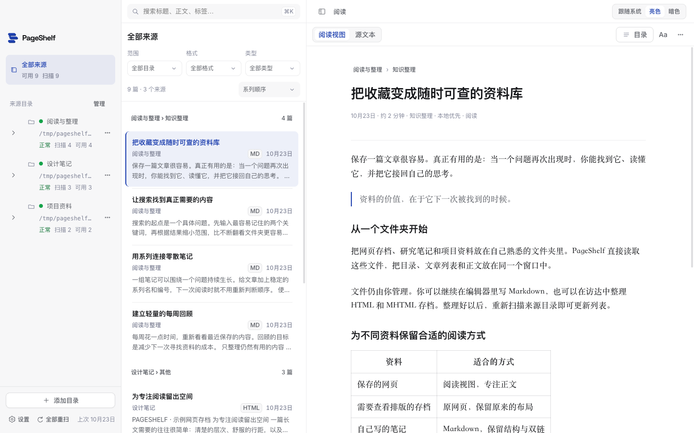
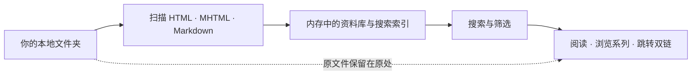
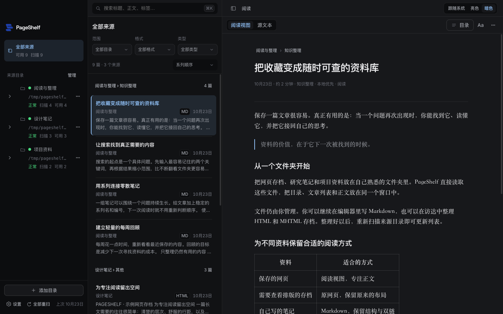
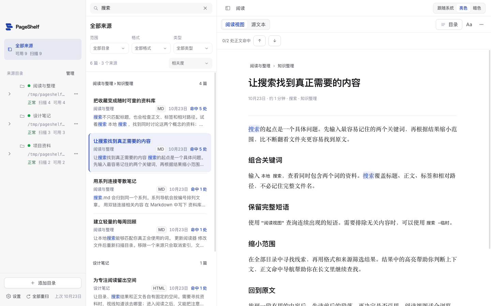
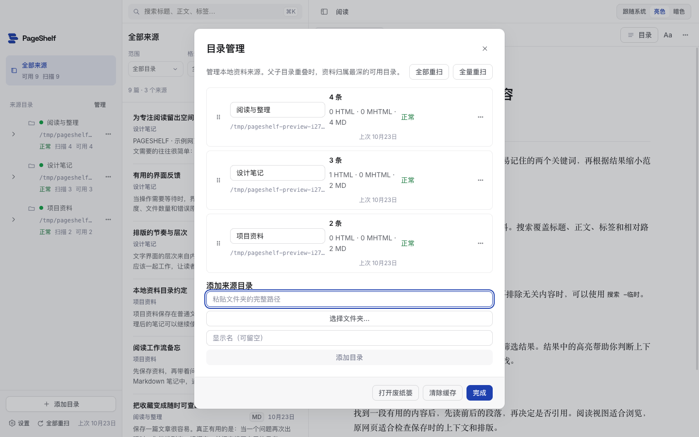

<div align="center">


[English](README.md) · **简体中文**

**把网页存档与 Markdown 笔记，放进同一个本地资料库。**<br>
文件留在原处，在 Mac 上搜索、阅读，沿着系列继续思考。

[](https://github.com/WYgao29/PageShelf/releases/latest)
[](#快速开始)
[](#功能)
[](docs/DEVELOPMENT.md)
[](https://github.com/WYgao29/PageShelf/commits/main)

[下载 Mac 版](https://github.com/WYgao29/PageShelf/releases/latest) · [快速开始](#快速开始) · [完整使用指南](docs/guide.zh-CN.md)



</div>

## 目录

[为什么做](#为什么做) · [功能](#功能) · [工作方式](#工作方式) · [快速开始](#快速开始) · [搜索语法](#搜索语法) · [界面截图](#界面截图) · [快捷键](#快捷键) · [常见问题](#常见问题) · [开发与验证](#开发与验证) · [参与贡献](#参与贡献)

## 为什么做

保存下来的网页，常常散落在不同的文件夹里。有用的文章变成了想不起的文件名，一组笔记失去了阅读顺序，找一句话需要逐个打开文件。

PageShelf 为这些文件提供一个共同的阅读空间。添加目录后，你可以搜索全文，在清爽的阅读视图与原网页之间切换，也可以按系列连续阅读。HTML、MHTML 和 Markdown 仍保存在原来的位置，继续使用你熟悉的编辑器和文件管理工具。

## 功能

| | 功能 | 说明 |
| --- | --- | --- |
| 📁 | **直接读取本地文件夹** | 添加多个来源，支持改名、排序、停用、重新定位和重扫。移除来源只取消索引，保留原文件。 |
| 📄 | **统一阅读三种格式** | 支持 HTML、MHTML 网页存档和 Markdown。同路径、同主干的多种格式合并为一个条目。 |
| 🔍 | **全文搜索** | 检索标题、正文、系列、标签、路径，支持多词组合、完整短语、排除词，以及来源、格式和文章类型筛选。 |
| 📖 | **专注阅读** | 按资料可用格式切换阅读视图、原网页与 Markdown，使用正文目录和命中导航定位内容。 |
| 🧵 | **系列与笔记连接** | 自动识别带编号的系列，支持上一篇、下一篇；Markdown 双链可跳转同一来源的笔记。 |
| 🌗 | **适合自己的阅读空间** | 亮色、暗色与跟随系统，四档字号，可调整三栏宽度，支持快捷键与导航状态恢复。 |
| 🖥️ | **在 Mac 本机运行** | 阅读和搜索均在本机完成。原网页脚本不执行，外链经确认后交给浏览器打开。 |
| 🗑️ | **使用系统废纸篓** | 移入废纸篓前列出关联文件；在访达中恢复文件后，重扫来源即可重新收录。 |

## 工作方式



应用启动时重建索引，并在本地缓存抽取后的正文。在其他工具中新增或修改文件后，重新扫描来源即可更新资料库。

## 快速开始

### 下载使用

1. 在 [Releases](https://github.com/WYgao29/PageShelf/releases/latest) 下载 `PageShelf-0.1.0-macOS-arm64.zip`。
2. 解压后将 **PageShelf.app** 拖到“应用程序”。当前版本适用于 **Apple Silicon Mac**。
3. 打开应用，点击 **添加目录**，选择保存网页或笔记的文件夹。

应用目前尚未签名和公证。如果 macOS 阻止打开下载的应用，请在“系统设置 → 隐私与安全性”中确认来源后，选择“仍要打开”。

### 试用示例资料

克隆或下载本仓库，将 `examples/library/reading`、`examples/library/design` 和 `examples/library/projects` 分别添加为来源。页面截图使用的就是这组原创示例文章。

### 从源码运行

需要 macOS，以及 Node.js 24 LTS（24.15 或更高的 24.x 版本）或 Node.js 26+。

```sh
git clone https://github.com/WYgao29/PageShelf.git
cd PageShelf
npm ci
npm run dev
```

构建 Apple Silicon 应用：

```sh
npm run package:mac
open release/PageShelf-darwin-arm64
```

## 搜索语法

| 查询 | 含义 |
| --- | --- |
| `本地 搜索` | 同时包含两个词 |
| `"阅读视图"` | 匹配完整短语 |
| `搜索 -临时` | 包含“搜索”，排除“临时” |

通过来源、格式和类型进一步缩小范围。文章列表和阅读区会高亮命中内容，`n` 与 `Shift+N` 可跳到下一处或上一处正文命中。

## 界面截图

| 暗色阅读 | 全文搜索 |
| --- | --- |
|  |  |

<details>
<summary><b>来源目录管理</b></summary>



</details>

全部截图来自真实桌面应用，使用仓库内的示例资料。当前界面语言为简体中文。

## 快捷键

| 快捷键 | 操作 |
| --- | --- |
| `⌘K` 或 `/` | 聚焦搜索 |
| `j` / `k` / `Enter` | 下一条 / 上一条 / 打开 |
| `[` / `]` | 系列上一篇 / 下一篇 |
| `v` | 切换阅读视图 |
| `n` / `Shift+N` | 下一处 / 上一处正文命中 |
| `t` | 切换主题 |
| `⌘\` | 显示或隐藏侧栏 |
| `Shift+M` | 目录管理 |
| `⌘[` / `⌘]` | 后退 / 前进 |
| `?` | 查看快捷键帮助 |

## 常见问题

<details><summary><b>资料会上传到云端吗？需要账号吗？</b></summary>

不会。阅读、索引和搜索均在本机运行，不需要云端账号或 AI API Key。
</details>

<details><summary><b>它能下载网页吗？</b></summary>

PageShelf 阅读已经保存在本地的文件。先用浏览器将网页保存为 HTML 或 MHTML，再将所在文件夹添加为来源即可。
</details>

<details><summary><b>移除来源会删除文件吗？</b></summary>

不会，只会取消索引。将文章移入废纸篓是单独的操作，会先列出全部关联文件并要求确认。
</details>

<details><summary><b>网页存档会与原网站完全相同吗？</b></summary>

应用提供抽取正文与原网页两种视图。网页脚本被禁用，远程图片不会自动加载；MHTML 内嵌图片和支持的本地图片可以显示。短 HTML 无法抽取足够正文时会退回原网页。
</details>

<details><summary><b>支持已读、收藏和阅读进度吗？</b></summary>

目前没有。应用会恢复导航、主题、字号和栏宽，不保存已读状态、收藏或滚动位置。
</details>

<details><summary><b>配置保存在哪里？</b></summary>

资料库配置和正文缓存在 `~/.html-library/`，界面设置在 `~/Library/Application Support/PageShelf/`。原始资料继续保存在你选择的文件夹里。
</details>

## 开发与验证

```sh
npm test
npm run check
```

[开发指南](docs/DEVELOPMENT.md) 说明项目结构、分项测试、打包和截图生成方法。[完整使用指南](docs/guide.zh-CN.md) 介绍目录管理、搜索、阅读与废纸篓恢复。

## 参与贡献

欢迎提交 [Issue](https://github.com/WYgao29/PageShelf/issues) 或 Pull Request。报告问题时，请提供 macOS 版本、文件格式，以及可以公开分享的最小示例。提交代码前运行与改动相关的测试。

第三方浏览器库和字体的许可声明保留在各自源码目录中，并随应用打包。详情见 [VENDOR.md](src-ui/vendor/VENDOR.md) 和[第三方声明说明](docs/DEVELOPMENT.md#third-party-notices)。
