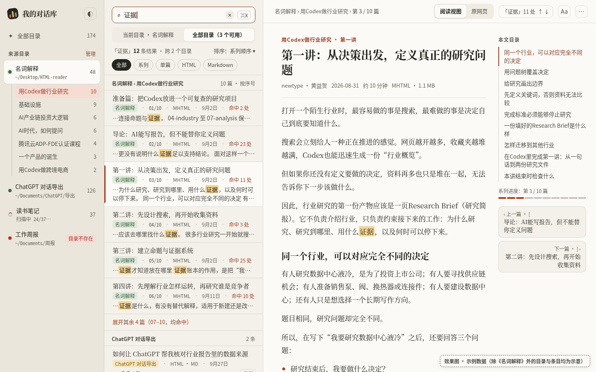
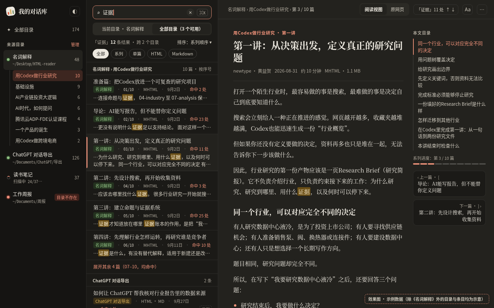
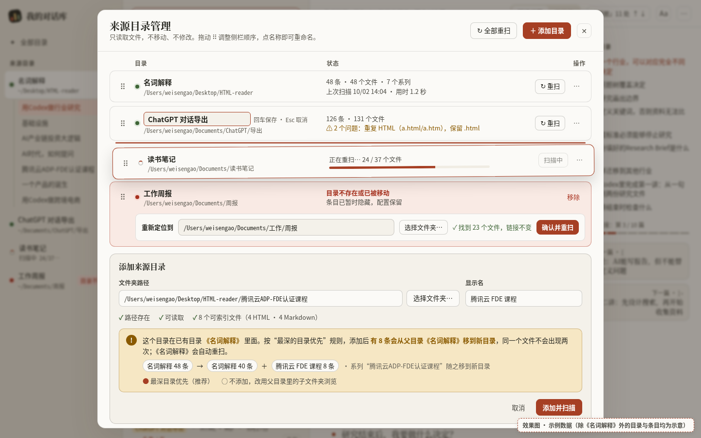

# HTML 知识库（我的对话库）完整改造方案

| 项目 | 内容 |
|---|---|
| 项目路径 | `/Users/weisengao/Documents/ChatGPT/HTML 知识库` |
| 文档版本 | 完整版 v3（2026-10-04），基于 v2，界面描述以效果图为准 |
| 前置文档 | `HTML知识库_WebUI改造方案.md`（v2）、`HTML知识库_WebUI改造方案_v1.md`（v1），都放在同一目录，保留不动 |
| 效果图 | `HTML知识库_效果图.html`（可交互），以及亮色主界面、暗色主界面、目录管理三张截图 |
| 目标读者 | 负责实施的开发者。本文写到了能直接排期、直接开工的程度 |

> 已经确定的 3 个决定（本文按这些写，不再讨论）
> 1. **父子目录重叠时，最深的目录优先**：同一个文件只归属路径最深的那个已启用目录，在库里只出现一次。
> 2. **删除就是移入 macOS 废纸篓**：可以恢复，**永远不调用 unlink**。
> 3. **允许内嵌 3 个单文件库**，Markdown 渲染、HTML 清洗、通用正文抽取各一个（见第 12 章）。直接放进仓库，不用 `npm install`、不打包、运行时不联网。

---

## 目录

1. 概述与目标
2. 需求范围（做 / 不做）
3. 需求清单（编号、优先级、验收标准）
4. 效果图
5. 信息架构与页面详细规格
6. 视觉规范
7. 多目录设计
8. 数据层
9. API 设计
10. 配置格式与迁移
11. 前端模块拆分与文件结构
12. 内嵌库选型
13. 测试方案
14. 分阶段实施、工期与验收
15. 风险与对策
16. 附录：A 现状问题清单 · B 现有代码在多目录上的差距 · C 效果图数据说明 · D 术语

---

## 1. 概述与目标

### 1.1 项目现状（一句话）

这是一个本机运行的 Node.js 服务，加一个原生前端单页。它扫描用户指定的文件夹，把散落的 `.html / .htm / .mhtml / .mht / .md` 合并成一个可以搜索的列表，源文件留在原处不动。没有任何 npm 依赖。服务端是 `src/server.js`、`src/library.js`、`src/service.js`，前端是 `public/index.html`、`app.js`、`styles.css`、`markdown-viewer.*`，测试用 `node --test`。

目前只配了 1 个目录 `~/Desktop/HTML-reader`（显示名“名词解释”），共 48 条：MHTML 36、HTML 8、MD 4。36 条 MHTML 都按 `系列_序号_标题` 命名，可以识别出 6 个系列；另外 `腾讯云ADP-FDE认证课程/` 子目录里的 4 篇 HTML 课程章节也会被识别成一个系列。

### 1.2 主要问题（详见附录 A）

- **分不清**：12 / 48 条的标题都是同一句“知识星球 \| 深度连接铁杆粉丝……”，摘要是网站导航文字。
- **乱序**：没有系列概念，按修改时间排序，课程顺序被打乱。
- **读着累**：每次阅读都开新标签页，三种格式三种样式，Markdown 渲染能力弱，front-matter 当正文显示。
- **有 bug**：提示条从来不显示；“上次扫描”时间一直不更新；扫描没有加载状态；后台服务和手动启动抢端口，日志里约 1.9 万行崩溃记录。
- **多目录只做了一半**：不能重命名、排序、单目录重扫；父子目录会重复收录；目录失效时没有任何提示。
- **删除不可恢复**：直接 `unlink` 源文件，确认只有一次 `confirm`。

### 1.3 改造目标

| 编号 | 目标 | 衡量方式 |
|---|---|---|
| G1 | 找得到 | 标题不重复；系列按序号排；搜索结果按相关度排，有命中片段和高亮；可以跨目录搜，也可以只搜当前目录 |
| G2 | 读得舒服 | HTML / MHTML / MD 统一用阅读视图，带文章目录（TOC）和上一篇 / 下一篇，随时能切到原网页 |
| G3 | 管得了多个目录 | 添加、重命名、排序、重扫、重新定位、停用；重叠时自动按“最深优先”处理；失效时看得见、修得了 |
| G4 | 稳、安全、好维护 | 修掉现有 bug；删除可以恢复；源文件只读；HTML 清洗加 CSP 双保险；模块化；测试测行为 |
| G5 | 舒适的桌面体验 | 三栏布局；暗色模式；快捷键；对比度 ≥ 4.5:1；正文 ≥ 14px |

### 1.4 设计原则

1. **桌面优先**：设计宽度 1440×900，最小支持 1024 宽。不做手机。
2. **源文件只读**：唯一会改动源文件的操作是“移入废纸篓”。缓存和配置全部放在 `~/.html-library/`。
3. **零构建**：浏览器直接加载原生 ES Module；内嵌库放在仓库里；`npm start` 就能跑。
4. **状态写进 URL**：当前目录、系列、搜索、筛选、正在读的条目、视图，刷新后都能还原。
5. **延续现有视觉**：米色纸张、衬线标题、橙红强调色。对比度按 WCAG AA 修正。
6. **失败可见**：每个目录的状态、扫描问题、抽取失败都要在界面上看得到，不能悄悄吞掉。

---

## 2. 需求范围

### 2.1 做

1. 电脑浏览器使用（Chrome / Safari / Edge 近两个大版本），窗口宽度 ≥ 1024px。
2. 只索引 `.md / .html / .htm / .mhtml / .mht` 五种扩展名。
3. 多目录：添加、移除、重命名、拖动排序、单目录重扫、全部重扫、重新定位、停用 / 启用、按目录浏览、跨目录或当前目录搜索；处理父子重叠（最深优先）、同名文件和目录失效；配置升级到 v2 并兼容旧配置。
4. 内容识别：智能标题、干净摘要、系列识别并按序号排序、Markdown front-matter 和 `[[双链]]`。
5. 三栏界面：左栏是目录、系列、状态；中栏是搜索、范围切换、筛选、排序、按系列分组的列表和高亮；右栏是阅读视图 / 原网页切换、文章目录、上一篇 / 下一篇、文内命中跳转。
6. 目录管理弹窗：重命名、拖动排序、重扫、重新定位、移除、停用、添加目录（实时校验，并提示重叠影响）。
7. 亮色 / 暗色主题（默认跟随系统，可以手动切换），快捷键，可访问性达标。
8. 删除改为移入 macOS 废纸篓。
9. 修复现有 bug，处理后台服务的端口冲突。

### 2.2 不做

- 手机和平板适配、PWA、扫码配对、局域网或 Tailscale 远程访问。现有 `AUTH_TOKEN` 代码保留原样，不扩展、不删除。服务默认仍然只监听 127.0.0.1。
- 阅读进度、收藏、已读、稍后读，以及任何“用户阅读状态”的存储和同步。
- 视频（.mp4）、.txt、PDF、图片等其他文件类型。
- 修改源文件内容、复制或搬运源文件、云同步、多用户、数据库。
- 自动监听文件变化（fs.watch）。本期只做手动重扫，留作以后的扩展点。
- 应用内“从废纸篓恢复”。恢复走 Finder 的“放回原处”。

### 2.3 约束

- Node.js ≥ 20。用户 Mac 上实际运行的是 v26.8.1。macOS 26.6.2 自带 `/usr/bin/trash`，已经在用户 Mac 上确认存在。
- 运行时没有 npm 依赖。内嵌库属于“仓库内的静态文件”，只在浏览器里加载。
- 不允许任何外部网络请求，CSP 要禁止外连。
- 现有安全机制全部保留：目录白名单、realpath 加边界校验、`O_NOFOLLOW`、源 HTML 响应带 CSP sandbox。

---
## 3. 需求清单

优先级：**P0** 必须有（首个可用版本必须包含），**P1** 应该有（本期完成），**P2** 可以有（时间允许再做）。

### 3.1 多目录（D）

| 编号 | 需求（用户故事） | 优先级 | 验收标准 |
|---|---|---|---|
| D1 | 我可以通过 macOS 文件夹选择器或手动输入路径添加目录，并设置显示名 | P0 | 添加后只扫描新目录（以及受重叠影响的父目录），耗时与该目录大小成正比；显示名默认用文件夹名；路径不存在、不是目录或不可读时，给出中文错误，且不写入配置 |
| D2 | 我可以移除目录，移除只是不再扫描 | P0 | 源文件一个都没变（测试里对比文件的 mtime 和数量）；该目录的条目从列表里消失；如果它是某个目录的子目录，父目录会重扫并收回这部分条目 |
| D3 | 我可以重命名目录的显示名 | P0 | 在侧栏双击，或在管理弹窗里点名称，就能就地编辑；Enter 保存，Esc 取消；1–40 个字符，去掉首尾空格；重命名后条目 ID 和 URL 不变，不触发扫描 |
| D4 | 我可以拖动调整目录顺序 | P1 | 在管理弹窗里拖动 ⠿ 把手，有落点提示线；松手后侧栏立即按新顺序显示，刷新后不变；键盘可以用 Alt+↑/↓ 调整 |
| D5 | 我可以按目录浏览，并看到每个目录的条数和状态 | P0 | 侧栏每个目录显示状态点、显示名、缩写路径和条数；点击后中栏只显示该目录内容，URL 变成 `/r/:rootId`；“全部目录”的条数 = 所有可用目录条数之和 |
| D6 | 我可以跨目录搜索，也可以只搜当前目录 | P0 | 搜索框下方有“当前目录 · {名称} / 全部目录”两段式切换；在某个目录里搜索时默认只搜当前目录；跨目录结果每条都带目录标签；切换范围后 URL 里的 `scope` 同步变化 |
| D7 | 我可以只重扫一个目录，也可以全部重扫 | P0 | 单目录重扫时，其他目录的列表照常可以浏览和搜索；扫描中状态点转圈，显示“扫描中 n/N”；全部重扫逐个目录排队 |
| D8 | 目录失效时我能看到原因，并能重新定位或移除 | P0 | 状态区分“不存在或已被移动 / 没有读取权限 / 不是文件夹”；侧栏显示红色“目录不存在”标签；弹窗里有“重新定位到…”入口，校验通过后 `path` 更新，条目 ID 保持不变 |
| D9 | 父子目录重叠时按最深优先处理，同一个文件只出现一次 | P0 | 父目录和子目录同时添加后，子目录里的每个文件只出现在子目录；添加前展示影响“有 N 条会从父目录《X》移到新目录”；N 必须和实际一致（真实数据：添加 `腾讯云ADP-FDE认证课程` 时 N = 8） |
| D10 | 不同目录的同名文件是独立条目，能区分开 | P0 | 跨目录视图里每条带目录标签；同一目录不同子文件夹的同名文件显示相对路径 |
| D11 | 系列只在目录内部识别 | P1 | 不同目录的同名系列分开显示，“全部目录”下系列名后面带目录名；每个目录可以关闭系列识别 |
| D12 | 旧配置可以无缝升级 | P0 | 用现有的 `config.json` 启动后，48 条记录的 ID 和升级前完全一致；生成 `config.v1.bak.json`；配置里不认识的字段被保留 |
| D13 | 我可以停用一个目录 | P2 | 停用后不扫描、不计数、不参与搜索，状态点变灰；配置保留；启用后自动扫描 |
| D14 | 我可以看到每个目录的扫描详情 | P1 | 管理弹窗每行显示条数、文件数、系列数、上次扫描时间和用时、问题数；问题列表可以展开（重复格式、读取失败、被排除的子目录） |

### 3.2 内容识别（C）

| 编号 | 需求 | 优先级 | 验收标准 |
|---|---|---|---|
| C1 | 每条显示真实标题 | P0 | 真实目录的 48 条里没有两条显示标题相同；12 篇知识星球文章显示文件名里的标题（如“唯有中间层值得长期投入”）；newtype 文章去掉开头的 🐴 和重复的标题 |
| C2 | 摘要来自正文 | P0 | 摘要里不出现“笔记 榜单 我的足迹 退出登录”这类导航词；最多 120 字；跳过和标题重复的句子以及“来自：xxx”这样的署名行 |
| C3 | 识别系列并按序号排 | P0 | 真实目录识别出 7 个系列：用Codex做行业研究 10、基础设施 9、AI产业链投资大逻辑 6、AI时代，如何提问 6、腾讯云ADP-FDE认证课程 4、一个产品的诞生 3、用Codex做跨境电商 2；系列视图按 01…10 排序 |
| C4 | 支持 Markdown front-matter 和双链 | P1 | `bloom-learn/*.md` 的摘要和正文里不再出现 `title: … type: …`；`tags` 显示为标签；`index.md` 里的 `[[学习进度]]` 能跳转到同目录下的条目，找不到的显示成灰色不可点 |
| C5 | 只索引 5 种扩展名 | P0 | `.mp4`、`.txt`、`.DS_Store` 等一律忽略（现在已经如此，补测试） |

### 3.3 浏览与搜索（B）

| 编号 | 需求 | 优先级 | 验收标准 |
|---|---|---|---|
| B1 | 三栏布局，在页内阅读 | P0 | 1440 宽时三栏宽度分别是 252 / 384 / 自适应；点列表项在右栏打开，不开新标签页；浏览器后退回到上一个条目或列表状态 |
| B2 | 排序和筛选 | P1 | 排序可选：相关度（只在有搜索词时出现）、最近更新、标题、系列顺序；筛选 chip：全部 / 系列 / 单篇 / HTML（含 MHTML）/ Markdown |
| B3 | 搜索按相关度排，带命中片段和高亮 | P0 | 输入停顿 150ms 后出结果，本地 500 条以内响应 < 50ms；片段里关键词用 `<mark>` 高亮；结果按系列分组（见 5.4）；显示“N 条结果 · 跨 M 个目录” |
| B4 | URL 状态 | P1 | 复制当前 URL 在新标签页打开，能还原目录、系列、搜索、范围、筛选、排序、条目和视图 |
| B5 | 按子文件夹浏览 | P2 | 左栏“文件夹”区显示当前目录的子文件夹树；点击后中栏只显示该文件夹的内容 |

### 3.4 阅读（V）

| 编号 | 需求 | 优先级 | 验收标准 |
|---|---|---|---|
| V1 | 默认用阅读视图 | P0 | 36 条 MHTML 和 8 条 HTML 的正文抽取成功率 ≥ 95%；阅读视图统一排版：标题 28px、正文 17px、行高 1.85、行宽 ≤ 600px；清洗后的 DOM 里没有 `script`、`on*` 属性和 `javascript:` |
| V2 | 可以切到原网页 | P0 | 顶栏“阅读视图 / 原网页”两段式切换（按 `v` 也能切）；原网页在 sandbox iframe 里显示，不执行脚本；抽取失败时自动切到原网页，并提示“未能提取正文” |
| V3 | Markdown 渲染增强 | P1 | 支持 GFM 表格、任务列表、嵌套列表、h1–h6、图片（相对路径要过边界校验）、代码块、软换行合并成同一段 |
| V4 | 文章目录（TOC） | P1 | 由 h2/h3 生成；滚动时高亮当前小节；点击平滑跳转（开启“减少动态效果”时直接跳）；没有标题时隐藏 TOC |
| V5 | 系列内上一篇 / 下一篇 | P1 | TOC 下方显示系列进度条（第 n / N 篇）和上一篇、下一篇卡片；快捷键 `[` / `]` |
| V6 | 文内命中跳转 | P1 | 有搜索词时，顶栏显示“「词」n 处 ↑ ↓”，正文里高亮所有命中，可以逐个跳转 |
| V7 | 字号偏好 | P2 | `Aa` 面板提供 4 档字号，保存在 localStorage（属于界面偏好，不算阅读状态） |

### 3.5 删除与安全（S）

| 编号 | 需求 | 优先级 | 验收标准 |
|---|---|---|---|
| S1 | 删除就是移入废纸篓 | P0 | 从阅读区 `⋯` 菜单进入，弹出确认框，列出这条记录关联的全部源文件；确认后文件进入 macOS 废纸篓，可以在 Finder 里“放回原处”；整个过程不调用 `unlink`；移动失败时报错，文件保持原样 |
| S2 | 列表上没有删除入口 | P0 | 中栏的行上不出现删除按钮 |
| S3 | 阅读视图双重防护 | P0 | 浏览器端用 DOMPurify 清洗，页面同时带 CSP（`script-src 'self'`、禁止外连），iframe 原网页保持 sandbox |

### 3.6 基础质量（F）

| 编号 | 需求 | 优先级 | 验收标准 |
|---|---|---|---|
| F1 | 操作都有反馈 | P0 | 扫描、添加、移除、重命名、删除、出错都有 toast；扫描按钮有加载状态，扫描中不可重复点击 |
| F2 | 后台服务不再反复重启 | P0 | 端口被占用时打印“服务已在运行（端口 4321）”并以退出码 0 退出；重启 Mac 后 `stderr.log` 不再增长 |
| F3 | 暗色模式 | P1 | 默认跟随系统；左上角 ◐ 可以在“跟随系统 → 亮 → 暗”之间切换，存进 localStorage；首屏不闪白 |
| F4 | 快捷键 | P1 | 第 5.7 节的快捷键全部可用；输入框里不触发单字母快捷键 |
| F5 | 可访问性 | P1 | 第 6.4 节的对比度全部达标；最小字号 12px，正文 ≥ 14px；`:focus-visible` 清晰可见；Lighthouse 可访问性评分 ≥ 95 |
| F6 | 大列表性能 | P1 | 1000 条时，首屏列表渲染 < 100ms，滚动不掉帧（超过 200 条分批渲染） |

---

## 4. 效果图

效果图和本文放在同一目录（`~/Downloads`），下面用相对路径引用。效果图里的布局、组件、文案和配色是本文页面规格的**基准**；两者不一致时以本文文字为准，并同步更新效果图。

### 4.1 亮色主界面



展示内容：
- **左栏**：4 个目录及其状态。名词解释 48（正常，已展开 7 个系列，选中“用Codex做行业研究”）；ChatGPT 对话导出 126（正常）；读书笔记（转圈，扫描中 24/37）；工作周报（红色“目录不存在”）。底部是“＋ 添加目录”、设置、全部重扫和上次扫描时间。
- **中栏**：搜索“证据”，范围选“全部目录”，结果“12 条 · 跨 2 个目录”，排序“系列顺序”，格式 chip。按系列分组，序号 01/10…，前 6 篇加“展开其余 4 篇”；每条显示目录标签、MHTML、日期、命中次数和高亮片段；第二组是另一个目录的结果。
- **右栏**：路径（目录 › 系列 › 第 3/10 篇）、阅读视图 / 原网页切换、文内命中“「证据」11 处 ↑↓”、Aa、⋯；第一讲的阅读视图；右侧是 9 个小节的文章目录、系列进度条、上一篇和下一篇。

### 4.2 暗色主界面



和亮色版布局完全一样，配色换成暗色主题（token 见 6.1）。

### 4.3 目录管理弹窗



展示内容：
- **目录表**（每行带拖动把手）：
  - 名词解释：48 条 · 48 个文件 · 7 个系列 · 上次扫描时间和用时 · 重扫；
  - ChatGPT 对话导出：正在就地重命名（“回车保存 · Esc 取消”），并显示“2 个问题：重复 HTML”；
  - 读书笔记：正在被拖动，有落点线，同时在重扫（24/37 进度条）；
  - 工作周报：失效，红色“目录不存在或已被移动 · 条目已暂时隐藏，配置保留”，带“重新定位到…”（路径框、选择文件夹、“找到 23 个文件，链接不变”、确认并重扫）和“移除”。
- **添加来源目录**：路径（真实子目录 `腾讯云ADP-FDE认证课程`）、显示名、校验项（路径存在 / 可读取 / 8 个可索引文件）、黄色重叠提示“有 8 条会从父目录《名词解释》移到新目录”、数量变化“48 → 40 ＋ 8”、两个选项（最深目录优先 / 不添加）、取消和添加并扫描。

### 4.4 交互版

`HTML知识库_效果图.html` 是单文件静态页面，用浏览器直接打开即可：
- 左上角 ◐ 切换亮 / 暗；
- 点左栏“管理”或“＋ 添加目录”打开目录管理弹窗，点遮罩或 ✕ 关闭；
- 地址后加 `?theme=dark` 直接看暗色，加 `?view=manage` 直接看弹窗。

效果图的数据说明见附录 C。

---
## 5. 信息架构与页面详细规格

### 5.1 整体布局

```
┌ 左栏 .side 252px ┬ 中栏 .list 384px ┬ 右栏 .reader 剩余宽度 ─────────────────────┐
│ 品牌 + ◐          │ 搜索框 + 范围切换   │ 顶栏：路径 · 视图切换 · 文内命中 · Aa · ⋯ │
│ 全部目录          │ 结果信息 + 排序     │ ┌ 正文 ≤600px ──────┬ 目录 212px ┐        │
│ 来源目录 + 管理    │ 筛选 chip          │ │ 标题 / 元信息      │ 本文目录    │        │
│  目录行（含系列） │ 分组头             │ │ 阅读视图正文       │ 系列进度    │        │
│  …               │ 列表行 …           │ │                   │ 上一篇/下一篇│        │
│ ＋ 添加目录       │                    │ └───────────────────┴────────────┘        │
│ 设置 · 全部重扫    │                    │                                           │
└──────────────────┴────────────────────┴───────────────────────────────────────────┘
```

- 用 CSS Grid：`grid-template-columns: var(--w-side) var(--w-list) 1fr`，默认 252 / 384。
- 栏与栏之间的分隔线可以拖动：左栏 200–320px，中栏 320–520px。宽度存在 localStorage 的 `ui.paneWidths`。双击分隔线恢复默认宽度。
- **宽度适配**：
  - ≥ 1280px：右栏显示 TOC 列；
  - 1024–1279px：TOC 收进顶栏的“目录 ▾”下拉；
  - < 1024px：不专门适配，左栏可以用 `⌘\` 折叠，保证不出现横向滚动条。
- 整个页面不滚动，三栏各自独立滚动，滚动位置按路由保存在内存里，用于后退时恢复。

### 5.2 路由与 URL 状态

前端用 History 路由。服务端对所有不以 `/api/`、`/assets/` 开头的 GET 请求都返回 `index.html`。

| 路径 | 中栏内容 |
|---|---|
| `/` | 全部目录，按最近更新排序 |
| `/r/:rootId` | 某个目录，按最近更新排序 |
| `/r/:rootId/s/:seriesKey` | 某个系列，默认按系列序号排序 |
| `/r/:rootId/f/:path*` | 某个子文件夹（P2） |
| `/settings/roots` | 打开目录管理弹窗，背后的三栏保持当前状态 |

查询参数可以和上面任意路径组合：

| 参数 | 取值 | 说明 |
|---|---|---|
| `q` | 字符串 | 搜索词 |
| `scope` | `root` \| `all` | 搜索范围。在 `/r/...` 下默认 `root`，在 `/` 下固定 `all` |
| `fmt` | `html` \| `markdown` | 格式筛选，不填表示全部 |
| `kind` | `series` \| `single` | 只看属于系列的，或只看单篇 |
| `sort` | `relevance` \| `updated` \| `title` \| `series` | 排序，默认值见上表；有 `q` 时默认 `relevance` |
| `item` | itemId | 右栏打开的条目 |
| `view` | `reader` \| `original` \| `markdown` | 右栏视图，默认 `reader` |

- 改动 `q` 用 `history.replaceState`（打字时不产生历史记录）。
- 切换目录、系列、条目用 `pushState`。

### 5.3 左栏（目录栏）

**组件，从上到下：**

1. **品牌行**：logo、“我的对话库”（17px 衬线，600），右侧是 ◐ 主题按钮（30×30）。
2. **全部目录**：图标 ✦，文字，右侧是总条数。选中时背景是 `--surface`。
3. **分组标题“来源目录”**：12px，600，字距 .08em，颜色 `--ink-3`；右侧有“管理”链接，点开目录管理弹窗。
4. **目录行**（`RootItem`），按 `order` 排列：
   - 状态点 8px：
     - `ok` 绿（`--sage`）；
     - `scanning` 10px 转圈；
     - `warning` 琥珀（`--amber`）；
     - `missing` / `denied` / `not_directory` 红（`--red`）；
     - `disabled` 灰。
   - 显示名：14px、500，超长时省略。
   - 第二行（12px 等宽字体，`--ink-3`）：平时显示缩写路径（把 `/Users/<用户名>` 换成 `~`）；扫描中显示“扫描中 n/N…”；停用时显示“已停用”。
   - 右侧：条数（12.5px、等宽数字）。失效时换成红底的“目录不存在 / 无权限 / 不是文件夹”标签。
   - 悬停 0.5 秒后出现 tooltip：完整路径和上次扫描时间。
   - 交互：
     - 单击：进入该目录；
     - 双击显示名：就地重命名；
     - 右键或悬停后出现的 `⋯`：菜单项依次为“重扫此目录 / 重命名 / 在访达中显示 / 重新定位…（只在失效时显示）/ 停用（或启用）/ 移除…”。
5. **系列列表**（`SeriesList`）：只在当前选中的目录下面展开（选“全部目录”时，在各目录下面折叠显示，点击目录名旁的 ▸ 展开）。
   - 左边有缩进线，每项是系列名加篇数，13.5px。
   - 选中项用 `--accent-soft` 背景、`--accent` 文字。
   - 按系列名的自然顺序排序。
   - 系列超过 12 个时，显示前 12 个和“更多 n 个”。
6. **文件夹区**（P2）：当前目录的子文件夹树，默认折叠。
7. **底部**（固定）：
   - “＋ 添加目录”：38px 高的虚线按钮，`--accent` 色，点开管理弹窗并聚焦到添加表单；
   - 一行小按钮：“⚙ 设置”“↻ 全部重扫”，右侧显示“上次 10/02 14:04”。扫描中时这个位置换成“扫描中 2/3 个目录”。

**状态：**

| 状态 | 表现 |
|---|---|
| 没有任何目录 | 目录区显示“还没有来源目录”和一个“＋ 添加目录”按钮；中栏显示引导空状态（见 5.8） |
| 目录扫描中 | 状态点转圈，第二行显示进度；这个目录已有的旧结果继续显示（增量扫描完成后再整体替换） |
| 目录失效 | 红点加红色标签；点击进入后，中栏显示“目录不存在或已被移动”的空状态，附“重新定位… / 移除”按钮 |
| 目录停用 | 灰点，第二行显示“已停用”，不显示条数，点击后中栏提示“已停用，[启用]” |

### 5.4 中栏（列表）

**顶部区域（`ListHeader`，固定在顶部）：**

1. **搜索框**：40px 高，10px 圆角，聚焦时 1.5px `--accent` 边框。
   - 左边是 ⌕ 图标；有内容时右边出现 ✕ 清除按钮；最右是 `⌘K` 提示。
   - 输入停顿 150ms 后发请求。`Esc` 第一次清空输入，第二次让搜索框失焦。
   - 支持 `"短语"` 和 `-排除词`。
2. **范围切换**（`ScopeToggle`，两段式）：“当前目录 · {名称}”和“全部目录（n 个可用）”。
   - 在 `/` 下只显示“全部目录”，第一段禁用。
   - 没有搜索词时这个控件隐藏。
3. **结果信息行**：
   - 有搜索词时：“「词」N 条结果 · 跨 M 个目录”；
   - 没有搜索词时：“{范围名} · N 条”；
   - 右侧是排序下拉“排序：系列顺序 ▾”。
4. **筛选 chip**：全部 / 系列 / 单篇 / HTML / Markdown，单选，选中项用实心反色。

**列表区（`ItemList`）：**

- **分组规则**：
  - 排序为“系列顺序”，或者在系列视图里时：按系列分组。组头显示“目录 › 系列名”和“N 篇 · 按序号”。单篇条目归到“其他”组，排在最后。
  - 有搜索词且排序为“相关度”时：按目录分组（目录按 `order` 排）；组内先把同一系列的条目聚在一起、按序号排，各组之间按组内最高分排。效果图就是这种形态：组 1 是“名词解释 › 用Codex做行业研究”，组 2 是“ChatGPT 对话导出”。
  - 排序为“最近更新”或“标题”时：不分组。
  - 一组超过 6 条时，默认只显示前 6 条，下面加一行“展开其余 n 篇（07–10）”；有搜索词时文案是“…（均命中）”或“…（k 篇命中）”。
- **列表行**（`ItemRow`）：
  - 第 1 行：标题，15px 衬线 500，单行省略。
  - 第 2 行：元信息，12px，中间用 · 分隔：
    - 目录标签：跨目录视图里显示；在单个目录里不显示，以减少干扰。不同目录用不同的柔和底色，按目录 order 轮流取色：`--sage-soft`、`--amber-soft`……
    - 系列序号，等宽字体，如 `03/10`；
    - 格式：HTML、MHTML、MD；同时有多种格式时写成 `HTML · MD`；
    - 修改日期：同一年写成“9月2日”，跨年写成“2025年9月2日”；
    - 有搜索词时加上“命中 n 处”（`--accent` 色）。
  - 第 3 行：14px 的摘要或命中片段。普通行显示 1 行，当前选中的行显示 2 行。片段从命中位置之前最近的标点开始截取，关键词用 `<mark>` 标出。
  - 选中行：背景 `--surface`，左边有 3px 的 `--accent` 竖条。
  - 交互：
    - 单击：在右栏打开；
    - `⌘` + 单击：在新标签页打开原网页（`/api/items/:id/original`）；
    - 右键菜单：在新标签页打开原网页 / 在访达中显示 / 复制路径；
    - 键盘 `j/k` 移动选中、`Enter` 打开。
  - 选中行变化后，用 `scrollIntoView({block:'nearest'})` 保证它可见。
- **分批渲染**：超过 200 条时先渲染 100 条，用 `IntersectionObserver` 每次追加 100 条。

### 5.5 右栏（阅读区）

**顶栏（`ReaderBar`，56px）：**

| 元素 | 说明 |
|---|---|
| 路径 | “目录名 › 系列名 › **第 n / N 篇**”；不属于系列时写成“目录名 › 相对文件夹”。点目录名或系列名可以跳到对应的列表 |
| 视图切换 | 两段式：“阅读视图 / 原网页”。如果这条有 .md 文件，变成三段式“阅读视图 / 原网页 / Markdown”。纯 .md 条目只显示“阅读视图 / 源文本” |
| 文内命中 | 只在有搜索词时显示：“「词」n 处 ↑ ↓”。点箭头跳到上一处或下一处，当前那一处的高亮加深；也可以用 `n` / `Shift+N` |
| Aa | 字号面板（P2）：4 档，分别是 15 / 17 / 19 / 21px |
| ⋯ 菜单 | 在新标签页打开原网页、下载原文件（有多种格式时出子菜单）、在访达中显示、复制本地路径、条目信息（路径、大小、格式、修改时间、所属目录）、分隔线、**移入废纸篓…** |

**正文区（`ReaderView`）：**

- 两列 Grid：正文列（`max-width: 600px`）和 TOC 列（212px），间距 28px；左内边距 44px，右内边距 24px。
- **正文头**：
  - 第 1 行：系列名 · 第 n 讲，12.5px，600，`--accent`；
  - 标题：28px 衬线 600，行高 1.3；
  - 元信息行：13px，`--ink-3`，内容是“站点 · 作者 · 日期 · 约 n 分钟 · 格式 · 大小”，下面有一条分隔线。
- **正文**：17px 衬线，行高 1.85；段落间距 14px；h2 21px（上 28px、下 6px）；h3 18px；列表的圆点用 `--accent` 色；
  - 图片 `max-width: 100%`，加 `loading="lazy"`；
  - 表格超宽时横向滚动；
  - 代码块用等宽字体 13.5px，`--surface-2` 底色。
- **TOC 列（`Toc`）**：
  - 标题“本文目录”；
  - 列表左边有竖线，当前小节用 2px 的 `--accent` 左边框，文字也用 `--accent`；
  - 当前小节用 `IntersectionObserver` 判断：在视口上方 30% 以内的最后一个标题算当前小节；
  - 下面是“系列进度：第 n / N 篇”和 N 段的进度条（已读到的位置不记录，进度条只表示当前是第几篇）；
  - 再下面是上一篇 / 下一篇两张卡片（12px 小字“‹ 上一篇 · [”，加 14px 衬线标题）。
- **原网页视图**：`<iframe sandbox="allow-same-origin" src="/api/items/:id/original">`，铺满正文区。不允许脚本、表单和弹窗。
- **Markdown 源文本视图**：等宽字体，按原样显示，带行号。

**状态：**

| 状态 | 表现 |
|---|---|
| 没有选中条目 | 显示“最近更新”的 10 条快捷入口，以及库的统计（目录数、条数、上次扫描时间） |
| 加载中 | 骨架屏：标题条加 6 行段落条。超过 300ms 才显示，避免闪烁 |
| 正文抽取失败 | 自动切到原网页，顶部出现一条细提示“未能提取正文，已显示原网页 · [仍然尝试阅读视图]” |
| 源文件已被删除或移动 | “文件已不存在（可能已被移动或删除）· [重扫此目录]” |
| 目录失效 | “所在目录不可用 · [重新定位…]” |

### 5.6 目录管理弹窗（`RootManager`）

- 用 `<dialog>` 做模态弹窗，宽 1040px，最大高度 860px，16px 圆角。
- 打开时 URL 变成 `/settings/roots`；关闭（`Esc`、✕ 或点遮罩）后回到原来的 URL。

**头部**：标题“来源目录管理”，说明文字“只读取文件，不移动、不修改。拖动 ⠿ 调整侧栏顺序，点名称即可重命名。”；右边是“↻ 全部重扫”“＋ 添加目录”（主按钮）和 ✕。

**目录表**：列宽为把手 28px / 目录 1fr / 状态 330px / 操作 190px。

| 列 | 内容 |
|---|---|
| ⠿ 把手 | 拖动排序。拖起的行有阴影、稍微倾斜、`--accent` 边框，落点处显示 3px 的 `--accent` 线。键盘：聚焦到行上后按 `Alt+↑/↓` |
| 目录 | 状态点、显示名（点击变成输入框，下面提示“回车保存 · Esc 取消”）、完整路径（12.5px 等宽） |
| 状态 | 正常时：“48 条 · 48 个文件 · 7 个系列 / 上次扫描 10/02 14:04 · 用时 1.2 秒”。有问题时：“⚠ n 个问题：…”，可以展开。扫描中：“正在重扫… n / N 个文件”加 5px 高的进度条。失效时：红色粗体“目录不存在或已被移动”和“条目已暂时隐藏，配置保留” |
| 操作 | “↻ 重扫”（扫描中变成禁用的“扫描中”）和“⋯”（停用 / 启用、在访达中显示、移除）。失效时只显示红色文字按钮“移除” |

**失效行**：整行背景混入 `--red-soft`，下面展开“重新定位”子行：
- 内容：“重新定位到”、路径框、“选择文件夹…”、校验结果（如“✓ 找到 23 个文件，链接不变”）、主按钮“确认并重扫”。
- 校验规则和添加目录一样，包括重叠检测。如果新路径和其他目录重叠，就像添加时一样显示影响说明。

**添加来源目录面板**（点“＋ 添加目录”后在表格下方展开）：

| 区域 | 说明 |
|---|---|
| 文件夹路径 | 路径框加“选择文件夹…”（调用 `POST /api/system/choose-folder`）。输入停顿 300ms 后调用 `POST /api/roots?dryRun=1` 做实时校验 |
| 显示名 | 默认用文件夹名，可以改，1–40 个字 |
| 校验项 | ✓ 路径存在 / ✓ 可读取 / ✓ n 个可索引文件（x HTML · y Markdown · z MHTML）。不通过的项显示成红色 ✕ 和原因 |
| 重叠提示 | 只在有重叠时出现，琥珀色底，左边一个“!”圆标：<br>• 新目录是子目录：“这个目录在已有目录《X》里面。按‘最深的目录优先’规则，添加后**有 N 条会从父目录《X》移到新目录**，同一个文件不会出现两次；《X》会自动重扫。”<br>• 新目录是父目录：“目录《Y》在这个新目录里面。按‘最深的目录优先’规则，《Y》里的 N 条仍然归《Y》，新目录不会重复收录这些条目。”<br>• 数量变化：`X 48 条 → X 40 条 ＋ 新目录 8 条`，以及受影响的系列（“系列‘腾讯云ADP-FDE认证课程’随之移到新目录”）<br>• 选项：● 最深目录优先（推荐，已定规则）/ ○ 不添加，改用父目录里的子文件夹浏览（选这个会关闭面板，并跳到 `/r/X/f/子路径`） |
| 底部 | “取消”和“添加并扫描”（主按钮；校验没通过时禁用） |

- 完全相同的路径：校验项显示“✕ 该目录已添加为《X》”，“添加并扫描”禁用。

### 5.7 快捷键

所有单字母快捷键在输入框、可编辑区域或弹窗里都不触发。

| 按键 | 作用 |
|---|---|
| `⌘K` 或 `/` | 聚焦搜索框（并全选已有内容） |
| `Esc` | 清空搜索、取消重命名、关闭弹窗或菜单，按优先级依次处理 |
| `j` / `k` | 在列表里选中下一条 / 上一条（同时在右栏打开） |
| `Enter` | 打开选中项；在搜索框里按，打开第一条结果 |
| `[` / `]` | 系列里的上一篇 / 下一篇 |
| `v` | 在阅读视图和原网页之间切换 |
| `n` / `Shift+N` | 文内的下一处 / 上一处命中 |
| `g` 然后 `a` | 跳到“全部目录” |
| `g` 然后 `1`…`9` | 跳到第 1–9 个目录 |
| `Shift+R` | 重扫当前目录（在“全部目录”下就是全部重扫） |
| `Shift+M` | 打开目录管理 |
| `t` | 切换主题 |
| `⌘\` | 折叠或展开左栏 |
| `?` | 显示快捷键帮助浮层 |

### 5.8 空状态与错误状态

| 场景 | 位置 | 文案 / 操作 |
|---|---|---|
| 还没有任何目录 | 中栏 | “添加第一个来源目录，开始整理你的 HTML / Markdown 资料” · [＋ 添加目录] |
| 目录为空（0 个可索引文件） | 中栏 | “这个目录里没有 .md / .html / .mhtml 文件” · [重扫] [在访达中显示] |
| 目录失效 | 中栏 | “目录不存在或已被移动：{路径}” · [重新定位…] [移除] |
| 没有读取权限 | 中栏 | “没有读取权限。后台服务读取 桌面 / 文稿 / 下载 目录时，可能需要在 系统设置 → 隐私与安全性 → 完全磁盘访问权限 里允许 node” · [重试] |
| 搜索无结果，范围是当前目录 | 中栏 | “在《X》中没有找到「词」” · [在全部目录中搜索] |
| 搜索无结果，范围是全部目录 | 中栏 | “没有找到「词」。试试更短的关键词，或去掉排除词” |
| 筛选后为空 | 中栏 | “当前筛选下没有内容” · [清除筛选] |
| 服务连不上 | 全局横幅 | “无法连接本地服务（127.0.0.1:4321）。请确认后台服务在运行：npm run service:status” · [重试] |
| 配置文件损坏 | 全局横幅 | “配置文件损坏，已备份为 config.broken-时间.json，并以空配置启动” · [打开目录管理] |
| 移入废纸篓失败 | toast 和弹窗内 | “无法移入废纸篓：{原因}。文件没有被改动。” |
| 扫描有问题 | toast | “《X》扫描完成：n 条，发现 k 个问题” · [查看] |

### 5.9 弹窗与提示

- **移入废纸篓确认**（`<dialog>`，480px 宽）：
  - 标题：“移入废纸篓？”
  - 正文：“以下 n 个文件会被移到 macOS 废纸篓，之后可以在访达的废纸篓里‘放回原处’。”下面列出全部源文件路径（等宽字体）。
  - 按钮：[取消] [移入废纸篓]（主按钮，用 `--accent-fill`；因为可以恢复，不再要求输入标题确认）。
  - 成功后 toast：“已移入废纸篓：{标题}”，带 [在访达中显示废纸篓] 按钮。列表里这条移除，右栏打开同系列的下一篇；没有下一篇就清空右栏。
- **toast**：右下角，宽度不超过 360px，显示 3.2 秒，带操作按钮时显示 6 秒；同时最多叠 3 条；使用 `role="status"`，错误类用 `role="alert"`。
- **移除目录确认**：“移除《X》？只是不再扫描，不会删除任何文件。” · [取消] [移除]。

---
## 6. 视觉规范

所有颜色、字号、间距都用 CSS 变量定义在 `public/css/tokens.css` 里，组件里不允许直接写颜色值。

### 6.1 颜色 token

| Token | 用途 | 亮色 | 暗色 |
|---|---|---|---|
| `--bg` | 页面、中栏底色 | `#f4f1ea` | `#1b1a17` |
| `--side` | 左栏底色 | `#ebe6db` | `#151412` |
| `--surface` | 阅读区、卡片、选中行、弹窗 | `#fbfaf7` | `#23221e` |
| `--surface-2` | 分段控件底、代码块、进度条底 | `#f0ece3` | `#2b2a25` |
| `--ink` | 主文字 | `#25251f` | `#ece8df` |
| `--ink-2` | 次级文字、正文辅助 | `#4d4c45` | `#cfcabe` |
| `--ink-3` | 元信息、标签、提示 | `#625f56` | `#aaa498` |
| `--line` | 分隔线 | `rgba(37,37,31,.12)` | `rgba(255,255,255,.09)` |
| `--line-2` | 边框、把手、虚线 | `rgba(37,37,31,.20)` | `rgba(255,255,255,.17)` |
| `--accent` | 强调文字、链接、选中 | `#a63f24` | `#f0937a` |
| `--accent-fill` | 主按钮底色（配白字） | `#a63f24` | `#b14a2f` |
| `--accent-soft` | 选中系列背景 | `#f5ddd3` | `#3d2620` |
| `--sage` / `--sage-soft` | 正常状态、目录标签 1 | `#3e6536` / `#dfe8dc` | `#8fbf83` / `#24321f` |
| `--amber` / `--amber-soft` | 警告、重叠提示、目录标签 2 | `#8a5a00` / `#f6e7c4` | `#e6b85c` / `#3a2f17` |
| `--red` / `--red-soft` | 失效、错误、危险操作 | `#a8321f` / `#f7dcd5` | `#f08f7c` / `#3f211b` |
| `--mark` / `--mark-ink` | 搜索高亮的底色 / 文字 | `#f6d58e` / `#25251f` | `#6b4f16` / `#fff3d9` |
| `--shadow` | 弹窗阴影 | `0 20px 60px rgba(64,52,32,.14)` | `0 24px 70px rgba(0,0,0,.5)` |

- 目录标签的颜色按目录 `order` 依次取：`sage`、`amber`，后面再加 `--blue-soft #dde6f0 / #1f2a36`（文字 `#2f5577 / #9cc0e6`）和 `--plum-soft #ece0ec / #33243a`（文字 `#6d3f6d / #d5a8d5`），四种颜色循环使用。
- logo 的三根柱子沿用现有颜色 `#dd5f42`、`#d6b36a`、`#829a79`。这些只是装饰，不承载文字，不受对比度要求限制。

### 6.2 字体与字号

- 衬线（标题、列表标题、正文）：`"Songti SC","Noto Serif CJK SC",Georgia,serif`
- 无衬线（界面）：`-apple-system,BlinkMacSystemFont,"PingFang SC","Noto Sans CJK SC","Helvetica Neue",sans-serif`
- 等宽（路径、序号、快捷键）：`ui-monospace,SFMono-Regular,Menlo,monospace`

| 级别 | 字号 / 行高 / 字重 | 用在哪里 |
|---|---|---|
| display | 28px / 1.3 / 600 衬线 | 阅读区标题 |
| h2 | 21px / 1.35 / 600 衬线 | 正文 h2、弹窗标题 |
| h3 | 18px / 1.4 / 600 衬线 | 正文 h3 |
| body-read | 17px / 1.85 衬线（Aa 档位 15/17/19/21） | 阅读正文 |
| title-row | 15px / 1.45 / 500 衬线 | 列表标题 |
| ui | 14px / 1.6 | 默认界面文字、目录名、列表摘要 |
| ui-sm | 13–13.5px | 系列名、按钮、TOC、元信息行 |
| caption | 12–12.5px | 列表元信息、分组标题、路径、标签（**最小 12px**；效果图里的“示例”小标 11.5px 只用于效果图，正式实现不出现） |

### 6.3 间距、圆角与动效

- 间距按 4px 递进：4 / 6 / 8 / 10 / 12 / 14 / 16 / 18 / 20 / 24 / 28 / 44。
  - 左栏内边距 10px，目录行 8×10px；
  - 中栏头部 16×18px，列表行 8×18×8×20px；
  - 阅读区内边距左 44px、右 24px，正文上边距 30px。
- 圆角：标签 4–5px，chip 99px，按钮和输入框 8px，搜索框 10px，目录表的行 11px，弹窗 16px。
- 高度：搜索框 40px，阅读区顶栏 56px，主按钮 34px，小按钮 30px，“添加目录”按钮 38px。
- 动效：hover 和选中 120ms；toast 和弹窗 180ms；遵守 `prefers-reduced-motion`，开启后关掉位移和平滑滚动。

### 6.4 对比度（WCAG 2.1，已逐项计算）

| 组合 | 亮色 | 暗色 |
|---|---|---|
| `--ink` / `--bg` | 13.66 | 14.23 |
| `--ink` / `--surface` | 14.76 | 13.02 |
| `--ink-2` / `--bg`（亮）、`--ink-2` / `--surface`（暗） | 7.64 | 9.74 |
| `--ink-3` / `--bg` | 5.66 | 7.02 |
| `--ink-3` / `--side` | 5.13 | 7.43 |
| `--ink-3` / `--surface-2` | 5.41 | 5.80 |
| `--accent` / `--bg` 或 `--surface` | 5.54 / 5.99 | 6.94（surface） |
| `--accent` / `--accent-soft` | 4.81 | 6.12 |
| 白字 / `--accent-fill` | 6.25 | 5.40 |
| `--sage` / `--sage-soft` | 5.36 | 6.41 |
| `--amber` / `--amber-soft` | 4.84 | 7.11 |
| `--red` / `--red-soft` | 5.14 | 6.18 |
| `--mark-ink` / `--mark` | 10.88 | 6.92 |

- 所有文字组合都 ≥ 4.5:1。以后新增颜色必须补进这张表。
- 焦点样式统一为 `:focus-visible { outline: 2px solid var(--accent); outline-offset: 2px }`，不允许写 `outline: 0`。

### 6.5 主题切换

- `<html data-theme="light|dark">`。没有手动选择时，用 `prefers-color-scheme` 决定。
- `public/js/theme-boot.js` 在 `<head>` 里同步加载（不加 defer，只有几行），先读 localStorage 的 `ui.theme` 再设置 `data-theme`，避免首屏闪白。这个文件是同源的，所以 CSP 不需要 `unsafe-inline`。
- `<meta name="theme-color">` 写两条，分别带 media 条件。
- 原网页 iframe 不跟随主题。暗色下 iframe 外面加一圈 `--surface` 的 8px 边框做过渡。

---

## 7. 多目录设计

### 7.1 概念

- **来源目录（root）**：用户添加的一个文件夹，带 `id`、`path`、`label`、`order`、`enabled`、`options`。
- **可用目录**：`enabled = true` 并且状态是 `ok`、`warning` 或 `scanning`。
- **条目（item）**：同一目录内、同一相对路径（去掉扩展名）的一组源文件（html / mhtml / markdown，最多各一个）。
- **归属**：每个源文件只归属一个目录，就是所有可用目录里**路径最深、并且包含这个文件**的那个（已定规则）。

### 7.2 目录 ID 与条目 ID

- 新目录：`root-` 加 12 位随机十六进制（`crypto.randomBytes(6)`），和路径无关。
- 旧目录：保留原来的 `root-<sha1(path)前12位>`，这样现有的条目 ID 都不变。
- 条目 ID：`${rootId}:${sha1(相对路径去扩展名，用 / 分隔，NFC 规范化).slice(0,12)}`。现在的算法不做 NFC，迁移时用旧算法核对：真实数据里的文件名都是 macOS 默认的 NFC，加上 NFC 不改变结果；万一核对出不一致，那个目录保留旧算法（配置里写 `options.idAlgo: "v1"`）。
- 带来的效果：重命名不改变 ID；重新定位后，只要内部相对路径不变，ID 也不变；移除后再添加会得到新 ID（这是预期行为）。

### 7.3 目录状态机

```
          add/enable            scan ok           scan ok + issues
 (none) ───────────▶ scanning ───────▶ ok ◀───────────────▶ warning
                       ▲   │ root realpath 失败
          rescan /     │   ▼
          relocate ────┴─ missing | denied | not_directory
 disable: 任意 ──▶ disabled ──enable──▶ scanning
```

错误码怎么映射到状态：

| 错误码 | 状态 | 中文提示 |
|---|---|---|
| `ENOENT` / `ENOTDIR`（父级不是目录） | `missing` | 目录不存在或已被移动 |
| `EACCES` / `EPERM` | `denied` | 没有读取权限（附完全磁盘访问权限说明） |
| realpath 成功，但不是目录 | `not_directory` | 该路径不是文件夹 |
| 其他 | `error` | 扫描失败：{message} |

失效目录的条目从索引里拿掉，配置保留。前端显示失效状态，并提供“重新定位 / 移除”。

### 7.4 父子目录重叠：最深优先（已定）

**计算方式**：每次目录集合发生变化（添加、移除、启用、停用、重新定位、某个目录状态在可用和不可用之间切换），都重新计算每个可用目录的 `exclude` 集合：

```js
// roots: 可用目录，realPath 已经是规范化后的真实路径
for (const a of roots) {
  a.exclude = roots
    .filter(b => b !== a && isStrictlyInside(a.realPath, b.realPath)) // b 在 a 里面
    .filter(b => !roots.some(c => c !== b && c !== a
        && isStrictlyInside(a.realPath, c.realPath) && isStrictlyInside(c.realPath, b.realPath))) // 只排除直接子目录，更深一层由中间目录负责
    .map(b => b.realPath);
}
```

- `walkDirectory(dir, exclude)` 遇到 realpath 在 `exclude` 里的子目录就跳过，不往下走。
- 比较用的是 realpath，所以符号链接、`/Users/x/../x` 这类写法都能识别；APFS 默认不区分大小写，比较时先 `toLowerCase()`（启动时检测一次卷是否区分大小写，区分的话就不转小写）。
- 遍历时不跟随指向目录的符号链接（现在已经如此），所以不会因为链接绕回来而重复收录。

**影响预估**（`dryRun`）：
- 新目录 N 是已有目录 P 的子目录：`moved = P 当前条目里相对路径以 rel(P, N) + "/" 开头的条数`。真实数据：P = 名词解释，N = `腾讯云ADP-FDE认证课程`，moved = 8（4 HTML + 4 MD）。
- 新目录 N 是已有目录 C 的父目录：`kept = C 的条目数`，这些条目继续归 C，N 不重复收录。
- 受影响的系列：`seriesKey` 落在被移动范围里的系列，在提示里列出。

**联动扫描**：
- 添加或重新定位一个子目录：扫新目录，同时**用增量方式重建父目录**——父目录不用重读文件，直接按新的 exclude 把这部分条目从父目录拿掉即可。
- 移除或停用一个子目录：父目录要重扫被它占用的那棵子树（只扫这部分）。
- 子目录失效：父目录会重新覆盖这棵子树（自动收回，避免条目凭空消失）。在父目录的 issues 里记一条：“子目录《X》不可用，其内容暂归《父》”。

**界面提示**：见 5.6 的重叠提示。父目录的状态区显示“已排除子目录：《腾讯云 FDE 课程》”。

### 7.5 同名文件

| 情况 | 处理 |
|---|---|
| 同一目录、同一相对路径、不同格式 | 合并成一条；`html`、`mhtml`、`markdown` 各占一格；阅读区可以切换 |
| 同一目录、同一相对路径、同一格式（`.html` 和 `.htm`，`.mhtml` 和 `.mht`） | 按优先级保留 `.html` > `.htm`、`.mhtml` > `.mht`；记 `duplicate_format` 问题（“重复 HTML（a.html/a.htm），保留 .html”） |
| 同一目录、不同子文件夹里同名 | 不同条目；不在系列里时，元信息显示所在文件夹 |
| 不同目录里同名 | 不同条目；跨目录视图显示目录标签 |
| 标题相同、文件名不同 | 智能标题能解决大部分。剩下的在列表元信息里补上文件名 |

### 7.6 目录级系列

- 系列的唯一标识 `seriesKey = sha1(rootId + "\n" + 相对文件夹 + "\n" + 系列名).slice(0,10)`，用在 URL `/r/:rootId/s/:seriesKey` 里。
- 只在**同一个目录、同一个相对文件夹**里聚合，绝不跨目录合并。
- 识别规则见 8.3。目录可以设置 `options.series = "off"` 来关闭识别。
- 在“全部目录”视图里，系列名后面加上“· 目录名”。

### 7.7 扫描调度

- **索引结构**：`Map<rootId, RootIndex>`，其中 `RootIndex = { items: Map<itemId, Item>, series: Map<seriesKey, Series>, files: Map<absPath, FileMeta>, state }`。
- **每个目录一个任务队列**：同一时刻只有一个扫描在跑；扫描中又来了请求，就标记 `rerun = true`，当前这次结束后再扫一次（多次请求合并成一次）。
- **全局并发**：最多 2 个目录同时扫描。
- **增量扫描**：`files` 里存 `{ size, mtimeMs, ino, meta }`。`size`、`mtimeMs`、`ino` 三项都没变的文件，直接复用 `meta`，不读文件内容。变了的文件才读，读完提取元数据后立即丢掉全文。
- **扫描完成**后用新的 `RootIndex` 一次性替换旧的；搜索请求在任何时候都只读当前的快照。
- **各种操作触发什么**：

| 操作 | 触发 |
|---|---|
| 添加目录 | 扫描新目录；父目录按新 exclude 增量移出 |
| 移除目录 | 丢掉它的 RootIndex；父目录重扫被它占用的子树 |
| 重新定位 | 扫描这个目录（复用旧的 files 元数据没有意义，全量扫）；如果新位置和其他目录重叠，按 7.4 联动 |
| 重命名、排序、修改 options.series | 不扫描（修改 series 选项时只在内存里重算系列） |
| 停用 / 启用 | 停用：丢掉索引，按“移除”的规则联动；启用：按“添加”的规则联动 |
| 移入废纸篓 | 从索引里删掉这一条，并删掉对应的 files 记录 |
| 单目录重扫 / 全部重扫 | 增量扫描指定目录 / 逐个目录排队 |
| 服务启动 | 所有可用目录按 order 排队扫描；第一个目录扫完就开始响应请求（其余目录在界面上显示“扫描中”） |

### 7.8 移入废纸篓（已定）

- 服务端 `trash.js`：
  1. 按 `readSource` 现有的规则，逐个校验源文件：realpath 在目录边界内、`lstat` 是普通文件、不是符号链接。
  2. 优先执行 `execFile('/usr/bin/trash', ['--', ...paths])`。macOS 26 自带这个命令，已在用户 Mac 上确认存在。它会把文件移进当前用户的废纸篓。
  3. 如果 `/usr/bin/trash` 不存在，或者执行失败，退回 `osascript -e 'tell application "Finder" to delete (POSIX file "<path>" as alias)'`，一个文件执行一次。路径要严格转义，**只能通过 argv 传参，不能拼接成 shell 字符串**。第一次执行可能弹出“允许 node 控制访达”的系统授权。
  4. 两种方式都失败时，返回 500，错误码 `TRASH_FAILED`，**不允许退回 unlink**。
  5. 成功后从索引里删掉这条。返回结果里列出被移走的文件。
- 能否在 Finder 里“放回原处”：`/usr/bin/trash` 和 Finder delete 理论上都支持。实施时要在真机上手动验证一次，结果写进 README。
- 一条记录有多个源文件（比如 .html 和 .md）时，一次性全部移走。部分失败时，返回 207，列出成功和失败的文件，并重扫这一条。

---

## 8. 数据层

### 8.1 处理流水线（服务端扫描）

```
文件 → 读取（utf8；MHTML 用 latin1 解析 MIME，再按 charset 解码 html 部分）
     → 格式解析：html / mhtml(取 text/html 部分) / markdown(front-matter + 正文)
     → 元数据：title、series、site、author、publishedAt、tags
     → 正文文本：按站点规则截取正文区域 → 去掉标签 → 清理空白
     → excerpt（≤120 字）、searchText（标题 + 系列 + 标签 + 路径 + 正文）、readingMinutes、headings（TOC 预览）
     → 丢掉全文，只保留元数据
```

- 服务端**不做 HTML 清洗和渲染**：服务端只提取用来建索引的纯文本，不输出可执行的 HTML。阅读视图的正文抽取和清洗都在浏览器里做（见 8.5），利用浏览器原生的 DOMParser 加内嵌库，这样服务端可以继续零依赖。

### 8.2 智能标题（`metadata.js`）

按顺序取第一个可用的：

1. Markdown front-matter 里的 `title`。
2. Markdown 的第一个 `# 标题`。
3. 站点规则里定义的标题选择器（见 8.4），比如 newtype 的 `h1.title`。
4. `<title>`。但如果同一个目录里有 ≥ 3 个条目的 `<title>` 一模一样（比如“知识星球 \| 深度连接铁杆粉丝……”），就认为它是站点通用标题，跳过这一项。
5. 从文件名解析出的标题（见 8.3）。
6. 第一个 `<h1>`。
7. 文件名（去掉扩展名）。

后处理：
- 去掉 “ - 站点名”“ \| 站点名”“｜站点名”这类后缀（站点名来自规则表）；
- 去掉开头的装饰性 emoji（如 🐴），原样另存到 `titleRaw`；
- 合并连续空白，最长 120 字。

第 4 步的“同一目录重复 ≥ 3 次”需要在扫完整个目录后再做一轮处理，所以 `metadata.js` 输出的是候选标题列表，由 `library.js` 在目录扫描结束时统一决定。

### 8.3 系列识别

对每个条目的“相对文件夹 + 文件名（去扩展名）”依次匹配：

| 规则 | 正则 | 系列名 | 序号 | 标题 |
|---|---|---|---|---|
| R1 | `^(.+?)[_\s]+(\d{1,3})[_\s.-]+(.+)$` | 第 1 组 | 第 2 组 | 第 3 组 |
| R2 | `^(\d{1,3})[_\s.-]+(.+)$` | 所在文件夹的名字（在根目录下就不算系列） | 第 1 组 | 第 2 组 |

- 同一个（目录, 相对文件夹, 系列名）至少有 2 篇才算系列，否则当作单篇处理（标题仍然用解析出来的第 3 组）。
- 序号按数字排序；序号相同的，按文件名自然顺序排。
- 真实数据按这两条规则会得到 7 个系列（见 C3）。腾讯云课程用 R2，系列名取文件夹名“腾讯云ADP-FDE认证课程”。
- `bloom-learn/*.md`（log、index、学习进度、复习计划）不匹配任何规则，是单篇。

### 8.4 站点规则表（`public/js/shared/site-rules.js`，服务端和浏览器共用）

```js
export const SITE_RULES = [
  { id: "zsxq", name: "知识星球",
    match: { titleIncludes: ["知识星球"], hostIncludes: ["zsxq.com"] },
    content: [{ cls: "topic-detail" }, { cls: "talk-content-container" }],
    title: [{ cls: "topic-detail", tag: "h1" }],
    strip: [{ cls: "comment-container" }, { tag: "nav" }, { tag: "aside" }],
    titleSuffix: ["| 深度连接铁杆粉丝，运营高品质社群，知识变现的工具"] },
  { id: "newtype", name: "newtype",
    match: { selectorExists: [{ cls: "ql-editor" }] },
    content: [{ cls: "ql-editor" }],
    title: [{ tag: "h1", cls: "title" }],
    author: { textPattern: "来自：\\s*(\\S+\\s*\\S*)\\s+(\\d{4}年\\d{2}月\\d{2}日)" } },
  { id: "article", name: null, match: { selectorExists: [{ tag: "article" }, { tag: "main" }] },
    content: [{ tag: "article" }, { tag: "main" }] },
];
```

- 选择器只用 `{ tag?, cls?, id? }` 这种简单形式，这样服务端可以用自写的轻量扫描器实现（`src/html-scan.js`：按标签深度配对，找到第一个匹配的元素并截出它的 innerHTML，大约 120 行）；浏览器端直接转成 `querySelector` 用。
- 两个真实页面已验证：知识星球的 MHTML 里有 `.topic-detail` 和 `.talk-content-container`；newtype 的 MHTML 里有 `.post .ql-editor`，标题在 `h1.title`。
- 新增站点只需要在表里加一条，并在 `test/fixtures/sites/` 下放一个最小样例。

### 8.5 阅读视图流水线（浏览器）

```
GET /api/items/:id/document   ← 服务端返回解码后的完整 HTML 文本（MHTML 已把资源内联成 data URI，结果按 mtime 缓存）
  → new DOMParser().parseFromString(html, "text/html")   // 惰性文档：不执行脚本，不加载外部资源
  → 按 SITE_RULES 找正文容器 → 找到：克隆这个节点
                                → 没找到：new Readability(doc.cloneNode(true)).parse()   // 内嵌库 3
  → DOMPurify.sanitize(node, PURIFY_CONFIG)                // 内嵌库 2
  → 后处理：给图片加 loading=lazy；链接加 target=_blank rel=noopener；给标题生成 id；收集 h2/h3 生成 TOC；按搜索词包 <mark>
  → 插入 <article>
Markdown：GET /api/items/:id/source/markdown → 去掉 front-matter → marked.parse(md, {gfm:true}) 加 wikilink 扩展（内嵌库 1） → DOMPurify → 同样的后处理
```

`PURIFY_CONFIG`：
```js
{
  ALLOWED_TAGS: ["p","br","hr","h1","h2","h3","h4","h5","h6","ul","ol","li","blockquote","pre","code",
                 "table","thead","tbody","tr","th","td","img","figure","figcaption","a","strong","em","b","i",
                 "u","s","del","sup","sub","span","div","mark","input"],
  ALLOWED_ATTR: ["href","src","alt","title","colspan","rowspan","type","checked","disabled","id","data-wikilink"],
  ALLOWED_URI_REGEXP: /^(?:https?:|data:image\/|#|\/api\/items\/)/i,
  FORBID_TAGS: ["style","script","iframe","object","embed","form","link","meta","svg","math"],
  KEEP_CONTENT: true,
}
```

- 去掉所有 `style` 和 `class`，排版完全由阅读视图的 CSS 决定。
- `input` 只允许 `type=checkbox disabled`，用于任务列表，在后处理里强制加上 disabled。
- 图片只允许 `data:image/*`（MHTML 内联的资源），或经过边界校验的 `/api/items/:id/asset?path=`（Markdown 里的相对路径）。外部图片的 src 一律去掉，换成占位图并显示“外部图片未加载”，因为 CSP 本来也会拦截外连。
- **抽取失败的判定**：正文纯文本少于 200 字，或者 Readability 返回 null。这时自动切到原网页（见 5.5）。

### 8.6 缓存

| 缓存 | 位置 | 键 | 失效条件 |
|---|---|---|---|
| MHTML 解码结果（`/document`、`/original`） | `~/.html-library/cache/doc/<itemId>-<format>-<mtimeMs>-<size>.html` | itemId + 格式 + mtime + size | 文件变化；手动清除；总量超过 500MB 时按访问时间淘汰最旧的 |
| 索引元数据 | 内存 `RootIndex.files` | 绝对路径 + size + mtimeMs + ino | 文件变化 |
| HTTP | `ETag: "<mtimeMs>-<size>"`，`Cache-Control: no-cache` | — | 浏览器每次带 If-None-Match 校验，没变返回 304 |

- 索引不写磁盘：服务启动时全量扫描，目前 48 个文件约 1.2 秒，可以接受。如果以后文件到几千个，再考虑持久化 `files` 元数据。
- 设置里提供“清除缓存”（`DELETE /api/cache`）。

### 8.7 搜索（`search.js`）

- **预处理**：查询和索引文本都做 NFKC 规范化加小写；全角和半角统一。
- **语法**：用空格分词，多个词是 AND 关系；`"短语"` 按整体匹配；`-词` 表示排除。
- **匹配**：子串匹配（中文不分词也能有效召回）。
- **评分**：

  | 字段 | 权重 | 说明 |
  |---|---|---|
  | 标题 | 10（完全等于查询再 +15） | 命中次数封顶 3 |
  | 系列名 | 6 | |
  | 标签 | 5 | |
  | 文件名 / 相对路径 | 3 | |
  | 正文 | 1 × min(命中次数, 10) | |
  | 新鲜度 | + 2 × exp(-天数/90) | |

- **返回**：每条结果带 `hits`（正文命中总数）和 `highlights`，例如 `[{ field:"body", text:"…为什么研究、研究到哪里、用什么证据，以及何时可以停下来。", ranges:[[18,20]] }]`。片段取第一个正文命中位置，从它前面最近的标点（，。：；！？或空格，往前最多 25 字）开始，往后取 60 字。
- **范围**：`roots=a,b`（不传就是全部可用目录）、`series=key`、`fmt`、`kind`。
- **性能**：全量线性扫内存。目前 48 条约 2–3ms，预计 2000 条以内 < 50ms。超出时再引入倒排索引（作为扩展点，本期不做）。

---
## 9. API 设计

### 9.1 通用约定

- 只监听 `127.0.0.1:4321`。如果设置了 `AUTH_TOKEN`，沿用现有的令牌和 Cookie 机制，本期不改。
- JSON 响应统一带 `content-type: application/json; charset=utf-8`、`cache-control: no-store`、`x-content-type-options: nosniff`。
- 错误统一返回 `{ "error": { "code": "ROOT_NOT_FOUND", "message": "目录不存在", "details": {} } }`。旧接口仍然返回 `{ error: "..." }` 字符串，保证兼容。
- 写操作（POST / PATCH / PUT / DELETE）要校验 `Origin` 必须是同源（防止其他网页跨站请求本机服务），并且只接受 `content-type: application/json`。
- **主页面 CSP**：`default-src 'self'; img-src 'self' data:; style-src 'self'; script-src 'self'; frame-src 'self'; connect-src 'self'; object-src 'none'; base-uri 'none'; form-action 'none'`。
- 源文件和原网页响应保留现有的 sandbox CSP。

### 9.2 接口列表

| 方法 | 路径 | 作用 | 阶段 |
|---|---|---|---|
| GET | `/api/roots` | 目录列表（按 order 排好）、状态、统计 | P1 |
| POST | `/api/roots` | 添加目录；`?dryRun=1` 只校验并返回影响预估 | P1 |
| PATCH | `/api/roots/:id` | 修改 `label` / `path`（重新定位，支持 `?dryRun=1`）/ `enabled` / `options` | P1 |
| DELETE | `/api/roots/:id` | 移除目录（不动文件） | P1 |
| PUT | `/api/roots/order` | 整体调整顺序 | P1 |
| POST | `/api/roots/:id/scan` | 单目录重扫（异步，返回 202） | P1 |
| POST | `/api/scan` | 全部重扫（异步，返回 202） | P1（替换现有同步版本） |
| GET | `/api/scan/status` | 各目录的扫描进度（前端在扫描期间每 500ms 轮询一次） | P1 |
| GET | `/api/roots/:id/series` | 某个目录的系列列表 | P2 |
| GET | `/api/roots/:id/folders?path=` | 子文件夹树（P2 需求 B5） | P4 可选 |
| GET | `/api/items` | 列表和搜索（合并了现在的 `/api/library`） | P2 |
| GET | `/api/items/:id` | 条目详情，以及上一篇 / 下一篇 / 所属系列 | P2 |
| GET | `/api/items/:id/document` | 解码后的完整 HTML 文本，供阅读视图在浏览器里解析 | P2 |
| GET | `/api/items/:id/original` | 原网页（html 原样返回；mhtml 内联资源后返回），带 sandbox CSP | P2 |
| GET | `/api/items/:id/source/:format` | 源文件原文（保留，供 Markdown 用） | 已有 |
| GET | `/api/items/:id/download/:format` | 下载（保留） | 已有 |
| GET | `/api/items/:id/asset?path=` | Markdown 相对路径的资源（做边界校验，只允许图片类型） | P2 |
| POST | `/api/items/:id/trash` | 移入废纸篓（P0 先让旧的 DELETE 走 trash.js，新接口随 P3 界面一起上线） | P0 / P3 |
| POST | `/api/system/choose-folder` | 调用 macOS 原生文件夹选择器（从现在的 `/api/settings/choose-folder` 改名，旧路径保留） | P1 |
| POST | `/api/system/reveal` | 在访达中显示：`{ itemId }` 或 `{ rootId }`，执行 `open -R <path>` | P3 |
| DELETE | `/api/cache` | 清除文档缓存 | P2 |

兼容旧接口（保留到 P3 结束，之后删除）：`GET /api/settings`、`POST /api/settings/roots`、`DELETE /api/settings/roots/:id`、`GET /api/library`、`DELETE /api/items/:id`。最后这个在兼容期内内部改成调用移入废纸篓，**不再 unlink**。

### 9.3 请求与响应示例

**GET /api/roots**
```json
{
  "roots": [
    {
      "id": "root-2e61579df9d2", "label": "名词解释", "path": "/Users/weisengao/Desktop/HTML-reader",
      "displayPath": "~/Desktop/HTML-reader", "order": 0, "enabled": true, "options": { "series": "auto" },
      "state": { "status": "ok", "message": null, "excludes": [],
        "lastScan": { "startedAt": "2026-10-02T06:04:33.288Z", "completedAt": "2026-10-02T06:04:34.494Z",
                      "durationMs": 1206, "files": 48, "items": 48, "series": 7 },
        "issues": [] },
      "counts": { "items": 48, "html": 8, "mhtml": 36, "markdown": 4 }
    },
    {
      "id": "root-9f2c41aa07de", "label": "工作周报", "path": "/Users/weisengao/Documents/周报",
      "displayPath": "~/Documents/周报", "order": 3, "enabled": true, "options": { "series": "auto" },
      "state": { "status": "missing", "message": "目录不存在或已被移动", "lastScan": null, "issues": [] },
      "counts": { "items": 0 }
    }
  ],
  "totals": { "items": 174, "available": 3 }
}
```

**POST /api/roots?dryRun=1**（添加前的实时校验）
```json
// 请求
{ "path": "/Users/weisengao/Desktop/HTML-reader/腾讯云ADP-FDE认证课程", "label": "腾讯云 FDE 课程" }
// 响应 200
{
  "valid": true,
  "checks": { "exists": true, "isDirectory": true, "readable": true,
              "indexable": { "total": 8, "html": 4, "mhtml": 0, "markdown": 4 } },
  "duplicateOf": null,
  "overlap": {
    "type": "child_of",
    "parent": { "id": "root-2e61579df9d2", "label": "名词解释" },
    "moved": 8,
    "parentBefore": 48, "parentAfter": 40,
    "affectedSeries": [{ "name": "腾讯云ADP-FDE认证课程", "count": 4 }]
  }
}
```

- `overlap.type` 的取值：`null`、`child_of`（新目录在已有目录里面）、`parent_of`（新目录包含已有目录，这时字段是 `children: [{id,label,kept}]`）。
- 完全相同的路径：`valid:false`，`duplicateOf:{id,label}`。

**POST /api/roots**（真正添加）→ `201 { "root": {...}, "scan": { "queued": ["root-new", "root-2e61579df9d2"] } }`

**PATCH /api/roots/:id**
```json
{ "label": "ChatGPT 对话导出" }                              // 重命名 → 200 { root }
{ "path": "/Users/weisengao/Documents/工作/周报" }           // 重新定位 → 200 { root, scan:{queued:[...]} }
{ "enabled": false }                                        // 停用
{ "options": { "series": "off" } }
```
错误码：`LABEL_INVALID`（为空或超过 40 字）、`ROOT_INVALID`、`ROOT_NOT_DIRECTORY`、`ROOT_EXISTS`、`ROOT_NOT_FOUND`。

**PUT /api/roots/order** → `{ "ids": ["root-2e61579df9d2","root-a1","root-b2","root-9f2c41aa07de"] }`。必须正好包含全部 id，否则返回 400 `ORDER_MISMATCH`。

**POST /api/roots/:id/scan** → `202 { "queued": true, "position": 0 }`
**GET /api/scan/status** → `{ "running": [{ "rootId":"root-b2","files":{"done":24,"total":37} }], "queued": [] }`

**GET /api/items?q=证据&roots=&sort=relevance&limit=50&offset=0**
```json
{
  "total": 12, "tookMs": 3, "roots": 2,
  "items": [
    {
      "id": "root-2e61579df9d2:1a2b3c4d5e6f",
      "rootId": "root-2e61579df9d2", "rootLabel": "名词解释",
      "title": "第一讲：从决策出发，定义真正的研究问题",
      "titleRaw": "用Codex做行业研究：第一讲",
      "relativePath": "用Codex做行业研究_03_第一讲",
      "formats": { "html": null, "mhtml": { "size": 1141743, "updatedAt": "2026-09-02T01:54:00.000Z" }, "markdown": null },
      "updatedAt": "2026-09-02T01:54:00.000Z",
      "series": { "key": "c0ffee1234", "name": "用Codex做行业研究", "index": 3, "total": 10 },
      "site": "newtype", "author": "黄益贺", "publishedAt": "2026-08-31",
      "excerpt": "打开一个陌生行业时，最容易做的事是搜索，最难做的事是决定自己到底要知道什么。",
      "readingMinutes": 10, "tags": [],
      "score": 31.4, "hits": 11,
      "highlights": [{ "field": "body", "text": "为什么研究、研究到哪里、用什么证据，以及何时可以停下来。", "ranges": [[13, 15]] }]
    }
  ],
  "groups": [
    { "kind": "series", "rootId": "root-2e61579df9d2", "seriesKey": "c0ffee1234", "label": "名词解释 › 用Codex做行业研究", "itemIds": ["…"] },
    { "kind": "root", "rootId": "root-a1", "label": "ChatGPT 对话导出", "itemIds": ["…"] }
  ]
}
```

- 参数：`q`、`roots`（逗号分隔，不传表示全部可用目录）、`series`、`folder`、`fmt`（`html` 包含 mhtml）、`kind`、`sort`、`limit`（默认 100，最大 500）、`offset`。
- 分组由服务端计算（规则见 5.4），前端照着渲染就行。

**GET /api/items/:id**
```json
{
  "item": { "...同上，不含 highlights": true, "headings": [{ "level": 2, "text": "同一个行业，可以对应完全不同的决定" }] },
  "prev": { "id": "…", "title": "导论：AI能写报告，但不能替你定义问题", "index": 2 },
  "next": { "id": "…", "title": "第二讲：先设计搜索，再开始收集资料", "index": 4 },
  "series": { "key": "c0ffee1234", "name": "用Codex做行业研究", "total": 10 },
  "files": [{ "format": "mhtml", "path": "/Users/weisengao/Desktop/HTML-reader/用Codex做行业研究_03_第一讲.mhtml", "size": 1141743 }]
}
```

**GET /api/items/:id/document**
- 返回 `200 text/plain; charset=utf-8`，正文是解码后的 HTML 文本。
- 用 `text/plain` 是为了让人直接打开这个 URL 时浏览器不会渲染它。
- 响应头带 `ETag`、`x-source-format: mhtml`、`x-site-rule: newtype`（服务端预判的站点规则，前端可以直接用）。

**POST /api/items/:id/trash**
```json
// 请求
{ "confirm": true }
// 成功 200
{ "trashed": ["/Users/…/a.html", "/Users/…/a.md"], "method": "trash-cli", "itemId": "…" }
// 部分失败 207
{ "trashed": ["…/a.html"], "failed": [{ "path": "…/a.md", "message": "Operation not permitted" }] }
// 全部失败 500
{ "error": { "code": "TRASH_FAILED", "message": "无法移入废纸篓：…。文件没有被改动。" } }
```

---

## 10. 配置格式与迁移

### 10.1 存放位置

- 默认 `~/.html-library/`，可以用环境变量 `HTML_LIBRARY_DATA_DIR` 覆盖（测试时用）。
- 目录结构：
  ```
  ~/.html-library/
    config.json            当前配置（v2）
    config.v1.bak.json     迁移前的备份（只生成一次）
    config.broken-*.json   损坏时的备份
    cache/doc/…            文档缓存
  ```

### 10.2 config.json v2

```json
{
  "version": 2,
  "roots": [
    {
      "id": "root-2e61579df9d2",
      "path": "/Users/weisengao/Desktop/HTML-reader",
      "label": "名词解释",
      "order": 0,
      "enabled": true,
      "addedAt": "2026-09-01T14:21:33.516Z",
      "updatedAt": "2026-10-04T09:00:00.000Z",
      "options": { "series": "auto" }
    }
  ],
  "ui": {}
}
```

| 字段 | 类型 | 规则 |
|---|---|---|
| `version` | number | 固定为 2 |
| `roots[].id` | string | 旧的保留；新的是 `root-` 加 12 位十六进制 |
| `roots[].path` | string | 绝对路径，保存添加时的 realpath |
| `roots[].label` | string | 1–40 字，可以和其他目录重名（界面上以 order 区分），但重名时给出提醒 |
| `roots[].order` | number | 从 0 开始连续编号；每次保存时重新编号 |
| `roots[].enabled` | boolean | 默认 true |
| `roots[].options.series` | `"auto"` \| `"off"` | 默认 `"auto"` |
| `roots[].options.idAlgo` | `"v1"`，可选 | 只在 7.2 的核对出现不一致时写入 |
| `ui` | object | 预留，目前为空；界面偏好仍然存在浏览器的 localStorage |

**`exclude` 不写进配置**，每次运行时根据目录集合计算。

### 10.3 迁移规则（`src/config.js`）

1. 读取 `config.json`：
   - 文件不存在：返回空 v2 配置（这时不写盘）。
   - JSON 解析失败：把文件改名为 `config.broken-<ISO时间>.json`，返回空配置，并设置 `startupWarning`，前端会显示全局横幅。
2. 没有 `version`，或者 `version` 是 1：按 v1 处理：
   - 过滤掉不合法的条目（沿用现有的 `isRootConfig`）；
   - 每个条目保留 `id`、`path`、`label`、`addedAt`；没有 id 的按旧算法 `root-` + sha1(resolvedPath) 前 12 位补上，和现在的 `normalizeRoot` 一致；
   - 按数组下标补 `order`，`enabled = true`，`options = { series: "auto" }`。
3. 第一次需要写回时（任何修改都算），如果 `config.v1.bak.json` 不存在，先把原文件原样复制过去。
4. 写回：先读当前文件得到原始对象，再把已知字段合并上去，**保留顶层和每个 root 里不认识的字段**；写到临时文件再 `rename`（沿用现有的原子写法）。
5. `version` 比 2 大：只读模式启动，界面提示“配置来自更新的版本，修改已禁用”，不覆盖文件。
6. 迁移验收：用用户现有的配置 `{ roots:[{ id:"root-2e61579df9d2", path:"/Users/weisengao/Desktop/HTML-reader", label:"名词解释", addedAt:"2026-09-01T14:21:33.516Z" }] }` 做测试样例，断言迁移后 ID 不变、扫描得到的 48 个条目 ID 和旧版一致。

---

## 11. 前端模块拆分与文件结构

### 11.1 目标目录结构

```
HTML 知识库/
├── README.md                         更新：多目录、废纸篓、快捷键、内嵌库说明
├── package.json                      不加依赖；scripts 新增 "check": "node scripts/check-vendor.mjs"
├── docs/
│   └── 改造方案.md                    本文档的副本（可选）
├── scripts/
│   └── check-vendor.mjs              校验 public/vendor 里文件的 SHA-256 和 VENDOR.md 一致
├── src/
│   ├── server.js                     路由分发、静态文件、CSP、Origin 校验（缩减到 ~200 行）
│   ├── routes/
│   │   ├── roots.js                  /api/roots*、/api/scan*
│   │   ├── items.js                  /api/items*
│   │   └── system.js                 choose-folder、reveal、cache
│   ├── config.js                     v2 读写、迁移、备份
│   ├── roots.js                      目录状态、重叠和排除计算、dryRun 影响预估
│   ├── scheduler.js                  扫描队列（每个目录串行、全局并发 2、合并重复请求）
│   ├── library.js                    RootIndex、增量扫描、条目组装、系列聚合（现有逻辑在这里重构）
│   ├── formats/
│   │   ├── mhtml.js                  从 library.js 拆出来：MIME 解析、html 部分、内联资源
│   │   ├── markdown.js               front-matter、纯文本、标题
│   │   └── html.js                   去标签、实体解码
│   ├── html-scan.js                  轻量标签扫描器（实现站点规则的简单选择器）
│   ├── metadata.js                   标题候选、系列解析、作者和日期
│   ├── search.js                     查询解析、评分、片段、分组
│   ├── cache.js                      文档缓存（磁盘、按大小淘汰）
│   ├── trash.js                      移入废纸篓（/usr/bin/trash → Finder），带边界校验
│   └── service.js                    launchd（保留；plist 不变）
├── public/
│   ├── index.html                    三栏骨架 + 弹窗容器
│   ├── css/
│   │   ├── tokens.css                第 6 章的 token（亮 / 暗）
│   │   ├── base.css                  重置样式、排版、焦点、滚动条
│   │   ├── layout.css                三栏 Grid、分隔线拖动
│   │   ├── components.css            按钮、chip、分段控件、标签、toast、dialog、菜单、状态点
│   │   ├── sidebar.css  list.css  reader.css  manager.css
│   ├── js/
│   │   ├── theme-boot.js             同步加载，设置 data-theme（不是 module）
│   │   ├── main.js                   启动、全局快捷键、横幅
│   │   ├── router.js                 History 路由、解析和序列化 URL 状态
│   │   ├── api.js                    fetch 封装、错误归一化、轮询扫描状态
│   │   ├── store.js                  轻量状态容器（subscribe/set），包括 roots、items、selection、ui 偏好
│   │   ├── dom.js                    h()、清空、委托事件、focus trap
│   │   ├── shortcuts.js              快捷键注册、g 前缀、输入框保护
│   │   ├── shared/
│   │   │   └── site-rules.js         和服务端共用的站点规则（服务端 import 同一个文件）
│   │   ├── views/
│   │   │   ├── sidebar.js            品牌、全部目录、RootItem、SeriesList、底部
│   │   │   ├── list.js               ListHeader、ScopeToggle、分组、ItemRow、分批渲染
│   │   │   ├── reader.js             ReaderBar、视图切换、骨架屏、各种状态
│   │   │   └── manager.js            RootManager 弹窗、拖动排序、就地重命名、重新定位、添加面板
│   │   ├── reader/
│   │   │   ├── pipeline.js           document → 站点规则 / Readability → DOMPurify → 后处理
│   │   │   ├── markdown.js           去 front-matter、marked 配置、wikilink 扩展
│   │   │   ├── toc.js                生成 TOC 并跟踪滚动位置
│   │   │   └── find.js               文内命中高亮和跳转
│   │   └── components/
│   │       ├── toast.js  dialog.js  menu.js  segmented.js  splitter.js  skeleton.js
│   └── vendor/
│       ├── VENDOR.md                 库名、版本、来源 URL、SHA-256、许可证
│       ├── marked-18.0.14/           marked.esm.js、LICENSE
│       ├── dompurify-3.4.16/         purify.es.mjs、LICENSE
│       └── readability-0.6.0/        Readability.js、LICENSE.md
└── test/                             见第 13 章
```

- 删除的文件：`public/app.js`、`public/styles.css`、`public/markdown-viewer.html`、`public/markdown-viewer.js`。旧链接 `/assets/markdown-viewer.html?source=…` 返回 302，跳转到 `/r/:rootId?item=:id&view=reader`。
- 静态路由：`/assets/*` 对应 `public/*`（保持不变），`/assets/vendor/*` 加 `Cache-Control: max-age=31536000, immutable`（目录名里带版本号）。
- 共用模块：服务端用 `import { SITE_RULES } from "../public/js/shared/site-rules.js"`，同一个文件服务两端，里面不能引用 DOM 或 Node API。

### 11.2 前端约定

- 不用框架。每个视图导出 `mount(container, store)` 和 `update(state)`。DOM 只用 `h()` 和 `textContent` 创建，**禁止把用户数据拼进 innerHTML**。唯一允许写 innerHTML 的地方是 `reader/pipeline.js`，而且写进去的必须是 DOMPurify 的输出。
- store 的结构：
  ```js
  { roots: [], totals: {}, route: { rootId, seriesKey, folder, q, scope, fmt, kind, sort, item, view },
    list: { items: [], groups: [], total, loading }, reader: { detail, status, toc, find },
    scan: { running: [], queued: [] }, ui: { theme, paneWidths, fontStep } }
  ```
- 数据请求：路由变化时，列表和条目详情并行请求。列表请求带序号，过期的响应直接丢掉（沿用现在 `libraryRequestSerial` 的做法）。
- 扫描期间每 500ms 轮询一次 `/api/scan/status`。全部完成后刷新 roots 和列表，并弹出 toast。

---

## 12. 内嵌库选型（已定：允许内嵌，不联网、不打包）

| 用途 | 库 | 版本（2026-10-04 查到的 npm latest） | 许可证 | 文件 | 大小 | SHA-256 |
|---|---|---|---|---|---|---|
| Markdown 渲染 | **marked** | 18.0.14 | MIT | `lib/marked.esm.js` → `public/vendor/marked-18.0.14/marked.esm.js` | 45 KB | `528a1b88bef88fc27277e06036ce7f4afb6a220b18110ba57c09e292b24a7ce0` |
| HTML 清洗 | **DOMPurify** | 3.4.16 | MPL-2.0 OR Apache-2.0（选 Apache-2.0） | `dist/purify.es.mjs` → `public/vendor/dompurify-3.4.16/purify.es.mjs` | 82 KB | `c44274a7959cfdd4da871fa78a5d5fbbef55db68d118c5c0833bc4b5cf9633ad` |
| 通用正文抽取（站点规则不匹配时兜底） | **@mozilla/readability** | 0.6.0 | Apache-2.0 | `Readability.js` → `public/vendor/readability-0.6.0/Readability.js` | 88 KB | `34dcab3d0832d0019f02990eed6b6124e029e8c32b9f0c6f2550544ff8dff174` |

说明：

- **为什么选 marked，不选 markdown-it**：marked 官方就提供单文件 ESM（`marked.esm.js`，没有外部依赖），可以直接 `import`；markdown-it 15 的浏览器版是 UMD，需要再包一层。marked 内置 GFM（表格、任务列表、删除线），自定义扩展 API 写 `[[wikilink]]` 也很方便。
- **为什么选 DOMPurify**：它是浏览器端清洗的事实标准，ESM 单文件，直接利用浏览器的 DOM。服务端不输出 HTML，所以不需要 jsdom。
- **Readability 怎么加载**：它不是 ESM，文件末尾是 `if (typeof module === "object") module.exports = Readability;`。按需动态插入 `<script src="/assets/vendor/readability-0.6.0/Readability.js">`（经典脚本），加载后通过全局 `Readability` 调用。只有站点规则没有命中时才加载，**不修改库文件**。
- **获取方式**（只在开发机上做一次，运行时不联网）：
  ```bash
  curl -L https://registry.npmjs.org/marked/-/marked-18.0.14.tgz | tar xz   # 取 package/lib/marked.esm.js 和 LICENSE
  curl -L https://registry.npmjs.org/dompurify/-/dompurify-3.4.16.tgz | tar xz   # 取 package/dist/purify.es.mjs 和 LICENSE
  curl -L https://registry.npmjs.org/@mozilla/readability/-/readability-0.6.0.tgz | tar xz   # 取 Readability.js 和 LICENSE.md
  ```
  拷贝后运行 `node scripts/check-vendor.mjs` 校验 SHA-256 是否和上表一致。
- **VENDOR.md**：逐个记录库名、版本、来源 tarball URL、文件 SHA-256、许可证、引入日期和用途；升级时同时更新目录名、VENDOR.md 和测试。
- **许可证合规**：每个目录里放上原始的 LICENSE 文件。README 的“第三方组件”一节列出这三个库。这是个人自用、不对外分发的项目，没有额外义务；以后如果要分发，保留这些 LICENSE 就满足要求。
- **升级策略**：只在安全公告（DOMPurify 尤其要关注）或者确实需要新功能时才升级，升级后跑 XSS 用例集（13.4）。

---
## 13. 测试方案

### 13.1 原则

- 继续用 `node --test`，不引入测试框架。
- 测**行为**，不测字面量：把现在 `test/ui.test.js` 里那种匹配 CSS 字符串、文案的断言改写掉。
- 每个已定决策和每条 P0 验收标准都要有对应的自动化测试，或者明确写进手工验收清单。
- 测试数据用临时目录（`mkdtemp`），**绝不读写用户的真实目录**；需要真实结构时，从 `test/fixtures/` 里的脱敏最小样例复制。

### 13.2 单元测试（新增和改写）

| 文件 | 覆盖内容 |
|---|---|
| `test/config.test.js` | v1 → v2 迁移（用用户真实配置的结构），ID 不变；写回时保留未知字段；只生成一次备份；配置损坏时备份并以空配置启动；遇到更高版本时进入只读模式；order 重新编号 |
| `test/roots.test.js` | 重叠计算：相同路径拒绝；子目录、父目录、三层嵌套（只排除直接子目录）；子目录失效或停用后父目录收回；dryRun 的 moved 数量；通过符号链接和 `..` 写法也能识别重叠；大小写不敏感卷 |
| `test/scheduler.test.js` | 同一目录的扫描串行执行、重复请求合并、全局并发 2；扫描中旧快照仍然可读 |
| `test/library.test.js`（扩展） | 多目录：跨目录同名文件是独立条目；同一目录同格式重复时按优先级保留并记 issue；增量扫描（mtime 没变的文件不读，用 spy 统计 readFile 次数）；移入废纸篓后只删掉这一条；只认 5 种扩展名 |
| `test/metadata.test.js` | 标题优先级的每一步；站点通用标题（同一目录重复 ≥ 3 次）被跳过；后缀和 emoji 处理；系列 R1 / R2 规则、不足 2 篇不算系列、序号排序；front-matter 解析 |
| `test/html-scan.test.js` | 按标签深度配对、嵌套同名标签、自闭合标签、注释和 script 里出现的假标签、class 中含多个值 |
| `test/search.test.js` | AND 关系、短语、排除词；评分顺序（标题命中排在正文命中前）；片段从最近的标点开始截取；高亮区间准确；按 roots、series、fmt、kind 过滤；分组规则 |
| `test/trash.test.js` | 注入 `execFile` 桩：优先 `/usr/bin/trash`，失败时退回 osascript，再失败返回 TRASH_FAILED，**断言从未调用 unlink**（monkey-patch `fs.unlink` 和 `fs.promises.unlink`，一旦被调用就让测试失败）；边界外的路径和符号链接被拒绝；部分失败返回 207 |
| `test/markdown.test.js` | （浏览器模块里的纯函数，在 node 里直接 import）去掉 front-matter；wikilink 扩展把 `[[x]]` 解析成 token；同一目录内的匹配逻辑 |

### 13.3 API 测试（`test/server.test.js` 扩展、`test/e2e-smoke.test.js` 改写）

- roots 接口完整流程：添加（含 dryRun）→ 重命名 → 排序 → 停用 → 启用 → 重新定位 → 移除。每一步都检查 `config.json` 的内容，并且断言源目录的文件列表和 mtime 没有变化。
- 父子重叠的端到端测试：先加父目录，再加子目录，`GET /api/items` 里每个文件只出现一次，dryRun 的 moved 等于实际移过去的条数。
- 失效：添加后把临时目录改名 → 重扫 → 状态是 `missing` → PATCH 新路径 → 条目 ID 和改名前一致。
- `/api/items` 的搜索和分组、`/api/items/:id` 的上一篇 / 下一篇、`/document` 返回 `text/plain`、`/original` 带 sandbox CSP、`/asset` 的边界校验。
- 写接口的 Origin 校验（跨站 Origin 返回 403）。
- 兼容旧接口：`/api/library`、`/api/settings` 仍然可用；`DELETE /api/items/:id` 走废纸篓（用桩替代）。
- 启动：端口被占用时进程以退出码 0 退出，并打印提示（spawn 子进程测试）。

### 13.4 浏览器端测试

- **XSS 用例集** `test/fixtures/xss/*.html`（至少 20 个）：`<script>`、`onerror`、`javascript:` 链接、`<svg><script>`、`<math>`、`srcdoc`、`<base>`、`<meta http-equiv=refresh>`、CSS `expression`、`data:text/html` 链接、DOM clobbering（`id="location"`）等。
- **跑法**：`test/browser/run.html` 引入 pipeline，逐个处理用例并把结果写到页面上。`scripts/browser-test.mjs` 如果找到系统里的 Chrome（`/Applications/Google Chrome.app/...`），就用 `--headless=new --dump-dom` 跑一遍并解析结果；找不到 Chrome 就跳过并提示。这个脚本**不放进 `npm test`**，以免没有 Chrome 时整个测试失败，单独做成 `npm run test:browser`。
- **阅读视图样例**：知识星球、newtype、自生成报告 HTML、bloom-learn Markdown 各一个脱敏片段，断言抽取出的正文字数、标题和 TOC 条目数。

### 13.5 手工验收清单（每个阶段结束时用真实数据跑一遍）

1. 用真实配置启动后，48 条、7 个系列，标题没有重复。
2. 打开“用Codex做行业研究”系列，01–10 按顺序排；第一讲的阅读视图正文完整，TOC 有 9 项，上一篇 / 下一篇正确。
3. 搜索“证据”：结果按系列分组，片段高亮，能切换范围。
4. 打开知识星球“唯有中间层值得长期投入”：标题正确，阅读视图里没有导航栏和侧栏。
5. 添加子目录 `腾讯云ADP-FDE认证课程`：提示 8 条，添加后名词解释变成 40 条，新目录 8 条；移除新目录后恢复成 48 条。
6. 把一个测试目录改名：侧栏显示“目录不存在”；重新定位后链接还能打开。
7. 移入废纸篓（用测试文件）：文件出现在访达的废纸篓里，“放回原处”能恢复，重扫后条目回来。
8. 切换暗色模式，三个画面和效果图对照，没有明显偏差。
9. 第 5.7 节的快捷键逐个试一遍。
10. Lighthouse 可访问性 ≥ 95；后台服务的 `stderr.log` 不再增长。

---

## 14. 分阶段实施、工期与验收

按 1 名熟悉 Node 和原生前端的开发者估算，单位是人日。每个阶段结束都能单独上线（`npm test` 全部通过，并且做完对应的手工验收）。

| 阶段 | 内容 | 主要文件 | 人日 |
|---|---|---|---|
| **P0 快速修复** | 补 toast 样式、修首屏扫描时间、加扫描加载状态和禁用、焦点样式、对比度和最小字号、删除死 CSS、侧栏目录选中态和标题、`EADDRINUSE` 时正常退出；**同时把现有删除改成移入废纸篓**（先接上 `trash.js`，现有界面不变） | `public/styles.css`、`public/app.js`、`src/server.js`、`src/trash.js`（新）、`src/library.js`（deleteItem）、`test/trash.test.js` | 1 |
| **P1 多目录数据层** | config v2 和迁移、目录 ID 策略、`roots.js`（状态、重叠、dryRun）、`scheduler.js`、按目录拆分的 RootIndex 和增量扫描、不保留全文、新增 roots 接口、扫描改成异步加轮询状态、选择器接口改名、Origin 校验 | `src/config.js`、`roots.js`、`scheduler.js`、`library.js`、`routes/roots.js`、`routes/system.js`、`server.js`；测试 config、roots、scheduler、library、server | 3 |
| **P2 内容识别与阅读数据** | 拆出 `formats/*`、`html-scan.js`、`metadata.js`（标题、系列、作者）、`site-rules.js`、`search.js`（评分、片段、分组）、`cache.js`；新增 items 接口（列表、详情、document、original、asset）；引入内嵌库并写 VENDOR.md 和 check 脚本；浏览器端 `reader/pipeline.js`、`markdown.js` 先用一个临时页面跑通 | `src/formats/*`、`html-scan.js`、`metadata.js`、`search.js`、`cache.js`、`routes/items.js`、`public/js/shared/site-rules.js`、`public/js/reader/*`、`public/vendor/*`；测试 metadata、html-scan、search、markdown、XSS | 3 |
| **P3 三栏界面与目录管理** | 新的 `index.html` 和 CSS 拆分（tokens、亮暗）、router、store、api、侧栏（目录、系列、状态、右键菜单、双击重命名）、列表（搜索、范围切换、筛选、排序、分组、高亮、分批渲染）、阅读区（视图切换、骨架屏、各种状态）、目录管理弹窗（拖动排序、就地重命名、重扫进度、重新定位、添加面板加重叠提示）、快捷键、toast 和弹窗组件；删掉旧前端文件并加 302 跳转；改写 ui.test | `public/index.html`、`public/css/*`、`public/js/**`、`src/server.js`（History 回退、CSP） | 4 |
| **P4 阅读器完善与收尾** | TOC 滚动跟踪、系列上一篇 / 下一篇卡片和进度条、文内命中跳转、Aa 字号、在访达中显示、废纸篓确认弹窗接入新界面、空状态和错误状态逐个核对、README 更新、Lighthouse 优化、真机验证“放回原处”；可选：文件夹树（B5） | `public/js/reader/toc.js`、`find.js`、`views/reader.js`、`components/dialog.js`、`README.md` | 2（加 B5 再 +0.5） |
| **合计** | | | **13 人日**（含 B5 为 13.5） |

和 v2 相比（9.5–12 天）多出的部分：内嵌库接入和浏览器端阅读流水线（+1）、废纸篓（+0.5）、API 和 Origin 校验、异步扫描状态这些细化项（+1）、按效果图实现的组件细节（拖动排序、就地重命名、文内命中，+0.5）。

### 各阶段验收

| 阶段 | 验收标准 |
|---|---|
| P0 | 扫描、删除、出错都能看到 toast；首屏显示“上次扫描 …”；扫描中按钮禁用并且有动画；用 Tab 键能看到焦点框；侧栏选中目录后有高亮，标题也变了；重启后 `stderr.log` 不再增长；**界面上的“删除”实际把文件移进了废纸篓（真机确认），测试断言没有调用 unlink** |
| P1 | 用真实配置启动后 48 个条目 ID 不变，生成了 `config.v1.bak.json`；第 13.3 节的 roots 端到端测试全部通过；在临时目录里父子重叠时没有重复条目，dryRun 的数字准确；失效再重新定位后 ID 不变；单目录重扫期间，另一个目录的 `/api/library` 正常返回；内存里没有全文（用堆快照抽查，或者断言条目对象里没有 content 字段） |
| P2 | 真实数据 48 条标题不重复；识别出 7 个系列且序号正确；摘要里没有导航词；`/api/items?q=证据` 返回分组和高亮；临时页面里 36 篇 MHTML 的阅读视图抽取成功率 ≥ 95%；XSS 用例全部被清洗；`check-vendor` 通过 |
| P3 | 三个画面和效果图逐项对照（布局、组件、文案、配色）一致；第 13.5 节手工清单的第 1、2、3、5、6、8、9 项通过；不会新开标签页；URL 能完整还原状态；1000 条模拟数据时列表首屏 < 100ms |
| P4 | 手工清单全部 10 项通过；TOC 高亮准确；`[` `]` 和 `n` 可用；Lighthouse 可访问性 ≥ 95，最佳实践 ≥ 95；README 写清楚多目录、废纸篓、快捷键、内嵌库和完全磁盘访问权限 |

### 建议的提交节奏

每个阶段至少拆成 3–5 个提交：先补测试，再实现，最后清理。阶段结束打 tag（`ui-v2-p0` … `ui-v2-p4`）。P1 和 P2 都只做服务端加接口，旧前端仍然能用（兼容接口一直保留到 P3 结束）。

---

## 15. 风险与对策

| 风险 | 可能性 / 影响 | 对策 |
|---|---|---|
| 配置迁移出错，导致目录丢失或条目 ID 变化 | 低 / 高 | 迁移前备份；测试里用用户真实的配置结构断言 ID 一致；写回时保留未知字段；遇到更高版本只读 |
| `/usr/bin/trash` 在 launchd 后台环境下行为异常，或者 Finder 自动化授权被拒 | 中 / 中 | 两级回退加明确报错；**任何情况都不 unlink**；P0 就在真机上验证；README 写清楚授权步骤 |
| “放回原处”不可用（取决于系统实现） | 中 / 低 | 文件仍然在废纸篓里，可以手动拖回；把实测结果写进 README |
| macOS 隐私权限：后台服务读 桌面 / 文稿 / 下载 被拦截 | 中 / 中 | 映射成 `denied` 状态，附完全磁盘访问权限的说明；用户现在的目录在桌面，目前能正常读取，说明当前环境已授权 |
| 最深优先导致条目“搬家”，用户以为条目丢了 | 中 / 低 | dryRun 先预估并展示影响；父目录的状态里写明“已排除子目录”；子目录失效时父目录自动收回 |
| 站点改版导致正文抽取失败 | 中 / 低 | Readability 兜底，再不行自动切原网页；规则表方便补充；每个站点有 fixture 测试 |
| 清洗不严导致 XSS | 低 / 高 | DOMPurify 白名单、主页面 CSP 禁止内联脚本和外连、原网页用 sandbox iframe 加 CSP；XSS 用例集；DOMPurify 有安全公告就升级 |
| 本机服务被其他网页跨站调用（CSRF） | 低 / 中 | 写接口校验 Origin、只接受 JSON 请求体；服务只监听 127.0.0.1 |
| 浏览器端解析 1MB 的 MHTML 时卡顿 | 低 / 低 | DOMParser 解析 1MB 约几十毫秒；超过 300ms 显示骨架屏；`/document` 有磁盘缓存和 ETag |
| 增量扫描判断有误（mtime 精度、文件被替换） | 低 / 中 | 用 size + mtimeMs + ino 三项判断；“重扫”可以强制全量（`?full=1`） |
| 旧前端测试大量失败 | 高 / 低 | P3 一开始先改写 ui.test；P0–P2 不动旧测试的语义 |
| 后台服务和手动启动冲突 | 已发生 / 低 | P0 修 EADDRINUSE；README 写明“装了后台服务就不要再 npm start，开发时用 `PORT=4322 npm run dev`” |
| 工期超出 | 中 / 中 | P0–P3 是核心（11 天）；P4 里的 V7 和 B5 可以砍掉；每个阶段都能单独上线 |

**剩余待决问题**：无。v1 和 v2 的待决问题都已经由用户确认（只做电脑端、不做阅读状态、不纳入视频和 txt、最深优先、移入废纸篓、允许内嵌库），或者按推荐值写进了本文（继续叫“我的对话库”、默认阅读视图、延续米色纸张加衬线的视觉、测试随改造一起改写）。实施中如果发现需要偏离本文，先改文档再改代码。

---

## 16. 附录

### 附录 A：现状问题清单（证据）

| # | 问题 | 证据位置 | 对应需求 |
|---|---|---|---|
| A1 | toast 从来不显示 | `public/app.js:135` 加了 `show`，`public/styles.css` 里没有 `.toast.show` | F1 |
| A2 | 首屏不更新“上次扫描” | `public/app.js:87–89`，对比 `:81–82` | F1 |
| A3 | `.is-refreshing` 没有样式，扫描按钮可以连续点 | `public/app.js:91–92` | F1 |
| A4 | 输入框写了 `outline:0` | `public/styles.css:31`、`:33` | F5 |
| A5 | 大量 9–11px 文字；`#8d8b82` 在 `#f4f1ea` 上对比度 3.03:1，在侧栏 `#e9e5db` 上 2.72:1 | `public/styles.css` 多处 | F5 |
| A6 | 已经不用的弹窗样式 | `public/styles.css:36` | 维护性 |
| A7 | 12/48 条标题相同（“知识星球 \| …”） | `src/library.js:221–232`，真实 `/api/library` 数据 | C1 |
| A8 | 摘要是整页文字的前 220 字，混着导航 | `src/library.js:200–209`、`:375` | C2 |
| A9 | 固定按修改时间排序；没有系列 | `src/library.js:412` | C3、B2 |
| A10 | front-matter 被当成正文；`[[双链]]` 原样显示 | `public/markdown-viewer.js`、`src/library.js:211–219` | C4 |
| A11 | 每次阅读都开新标签页 | `public/app.js:26` | B1 |
| A12 | 格式导航和格式筛选重复 | `public/index.html:21–23`、`:46` | B2 |
| A13 | 删除是 unlink，只确认一次，入口在列表卡片上 | `src/library.js:469–476`、`public/app.js:119–134` | S1、S2 |
| A14 | 扫描时内存里保留全文（约 36MB）；任何修改都全量重扫 | `src/library.js:318–325`；`src/server.js:225、261、274` | 7.7 |
| A15 | MHTML 每次请求都重新解析并内联资源 | `src/library.js:164–188`、`:541–548` | 8.6 |
| A16 | 自写的 Markdown 渲染器不支持图片、嵌套列表、h4–h6、软换行 | `public/markdown-viewer.js:25–96` | V3 |
| A17 | 后台服务和手动启动抢端口：`stderr.log` 约 640KB、约 1.9 万行 `EADDRINUSE` | `~/Library/Logs/html-conversation-library/stderr.log`；`src/server.js:321–325` 没处理 listen 错误 | F2 |
| A18 | UI 测试逐字匹配 CSS 和文案 | `test/ui.test.js` | 13.1 |

### 附录 B：现有代码在多目录上的差距（在隔离环境里用 4 个目录实测）

| 方面 | 现状 | 差距 → 本方案对应章节 |
|---|---|---|
| 配置结构 | `{ roots:[{id,path,label,addedAt}] }`，没有版本号；写回时只写 `roots` | 没有 order、enabled、options；不认识的字段会丢；配置损坏时启动失败（所有请求返回 500）→ 第 10 章 |
| 目录 ID | 新目录用 `root-` + sha1(realpath) | 目录搬走后只能删掉重加，ID 和所有条目链接都会变 → 7.2 |
| 添加 | 只拒绝完全相同的路径 | 父目录和子目录能同时添加，实测同一个文件出现两次（`01_AI和Agent基础`、`bloom-learn/index`）→ 7.4 |
| 移除 | 移除后全量重扫 | 不必要的重扫 → 7.7 |
| 重命名、排序 | 没有 | → 5.6、9.3 |
| 扫描 | 串行扫全部目录；每个目录单独 try/catch；有扫描队列 | 不能单目录重扫；`lastScan` 全局只有一份；添加一个目录也全量扫 → 7.7 |
| 失效 | `errors` 里只记原始英文 `ENOENT: no such file or directory, realpath …`；条目直接消失 | 前端不展示；不区分原因；不能重新定位 → 7.3、5.6 |
| 符号链接 | 不跟随指向目录的链接；读文件用 `O_NOFOLLOW` 加边界校验 | 安全，保留 |
| 同名文件 | 同一目录内合并；同格式重复时保留一个并记 error；跨目录是独立条目 | 警告不展示；跨目录同名区分度弱 → 7.5 |
| 搜索 | 默认跨目录，支持单个 `rootId` | 不能多选目录；没有“当前目录 / 全部目录”的交互 → 5.4、8.7 |
| 前端 | 侧栏列出目录，点击后按 rootId 过滤；设置页只能添加和移除 | 没有选中态；标题不变；切换格式会丢掉目录过滤；条数是全局的；没有状态展示 → 5.3 |
| 测试 | 全部只用一个目录 | → 13.2、13.3 |

### 附录 C：效果图数据说明

- **真实数据**：
  - “名词解释 · ~/Desktop/HTML-reader · 48 条”和它的 7 个系列（名字和篇数）；
  - “用Codex做行业研究” 10 篇的标题、修改日期（9月2日、9月8日、9月11日）、“证据”命中次数（2 / 23 / 11 / 3 / 26 / 10 / 6 / 10 / 19 / 25）和片段；
  - 第一讲阅读视图的正文和 9 个小节标题（从用户的 MHTML 文件里只读抽取）；
  - 添加子目录时的“8 条（4 HTML · 4 Markdown）”。
- **示意数据**：
  - ChatGPT 对话导出（126）、读书笔记（37）、工作周报（失效）三个目录；
  - ChatGPT 目录下的 2 条结果；
  - 重新定位时的“找到 23 个文件”；
  - “2 个问题：重复 HTML”。
  
  页面右下角固定标注“效果图 · 示例数据（除《名词解释》外的目录与条目均为示意）”。
- 效果图里“示例”小标用的 11.5px 只用于效果图，正式实现不出现。效果图里结果数“12 条”是示意（10 篇真实结果加 2 条示例）。

### 附录 D：术语

| 术语 | 含义 |
|---|---|
| 来源目录（root） | 用户添加的扫描文件夹 |
| 条目（item） | 同一目录内同一相对路径（不含扩展名）的一组源文件 |
| 系列（series） | 同一目录、同一相对文件夹里，按 `系列_序号_标题` 或 `序号_标题` 命名、至少 2 篇的一组条目 |
| 最深优先 | 一个文件只归属包含它的、路径最深的可用目录 |
| 阅读视图 | 抽取正文并清洗后，套上统一排版的显示方式 |
| 原网页 | 源 HTML 或 MHTML 原样显示（sandbox，不执行脚本） |
| dryRun | 只校验、只预估影响，不真正修改的请求方式 |
